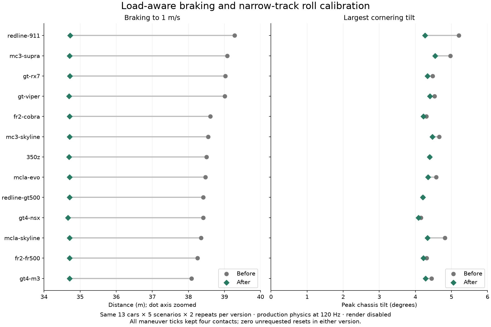
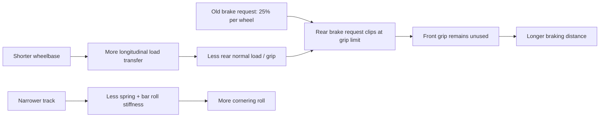

# Redline 911: diagnosed causes and tested fix

Historical experiment against the shared physics model. The subsequent [per-car profile study](../per-car-physics/README.md) retains load-following brakes and replaces equal-roll normalization with individually declared suspension estimates. Source links and regression commands below describe the version tested here.

**The braking penalty came from geometry interacting with an equal-per-wheel brake allocation. The tilt excess came mainly from the narrower track reducing roll stiffness under the shared suspension constants.** Two controlled changes address these independently: load-aware service braking and a baseline-derived minimum roll resistance for narrow tracks.

The same 130-run fleet matrix was repeated with the corrected executable: 13 cars × five scenarios × two repetitions. Prepared assets, scenario hashes and every effective input tick match the original study. All 130 candidate runs passed and all 130 retained provenance bundles verified.

| 911 measurement | Before | After | Change |
|---|---:|---:|---:|
| Distance to brake from ~98.36 km/h to 1 m/s | 39.28 m | 34.72 m | 11.6% shorter |
| Time to 1 m/s | 2.85 s | 2.50 s | 0.35 s shorter |
| Peak fast-turn tilt | 5.21° | 4.27° | 18.0% lower |
| Four-contact maneuver ticks | 100% | 100% | No contact loss |
| Unrequested resets | 0 | 0 | No unrequested resets |

**Tradeoffs:** the 911 exits the lower-speed turns about 1.14 m/s faster, with less slip, but its heading response decreases from 75.21° to 71.23°. In the faster turn, response decreases from 46.74° to 43.99° while exit speed rises from 26.03 to 26.61 m/s. Stronger braking increases braking pitch/tilt from 1.71° to 2.04°. The change improves braking and body control; it does not improve every handling metric. The roll component is an explicit arcade calibration, not a correction to the source model or a claim about a stock 911.



## Causal trace: geometry → forces → measurements

The catalog supplies wheel positions/radii. `CarSpec::mounts` keeps X/Z positions and sets the suspension mount height to 0.16 m. `baseline_mass_properties` assigns 1320 kg, local COM at zero and the same principal inertia to the fleet; the intact baseline-car assembly projects that same calibration. Body colliders have zero density, so changing their length/width does not recalculate mass or inertia. The effective CG height above the road comes from the chassis ride height under these authored fixtures. Sources: [roster.rs](../../../src/roster.rs#L48), [vehicle mass/collider setup](../../../src/vehicle.rs#L10), [assembly projection](../../../src/assembly/runtime.rs).

The 911 has a **2.33 m wheelbase** versus **2.65 m** for the baseline car, and **1.390/1.405 m front/rear tracks** versus **1.534/1.534 m**. These are prepared wheel-mount dimensions, retained by the fix. Source: [compiled roster](../../../assets/cars/roster.json).



### Braking: the requested force was available, but allocated poorly

The original controller requested `MASS * 10 / 4 = 3300 N` at each wheel, then clamped each tire's combined force to `1.22 × normal_load`. Longitudinal load transfer scales approximately with `mass × deceleration × CG_height / wheelbase`. The shorter wheelbase shifts more load away from the rear wheels during braking, so an equal split saturates those wheels earlier.

Over the same 200-sample window 0.33–2.0 seconds after braking begins, the 911's mean front/rear axle loads were **9262 / 4049 N**. Both rear tires were grip-limited throughout that window. The old split left **about 4700 N of front grip unused** while losing **about 1660 N of requested rear braking**. All four wheels still had contact: contact alone did not establish efficient use of grip. The baseline car lost about 1427 N at the rear; the longer-wheelbase M3 lost about 1284 N.

The fix uses each wheel's share of total measured normal load to allocate the same total service-brake request. It retains the tire-force grip circle, near-zero-speed force cap, handbrake behavior and reverse transition. No higher friction coefficient or stronger total brake command is introduced. Source: [braking_force](../../../src/vehicle/forces.rs#L9), [call site](../../../src/vehicle.rs#L300). Inspectable data: [force audit](brake-force-audit.json).

### Tilt: reduced track meant reduced roll resistance

With the old constants, each axle's small-angle roll stiffness is approximately:

`K_roll = (spring_rate / 2 + anti_roll_coefficient) × track²`

The shared constants were 38,000 N/m per corner and an anti-roll coefficient of 6500 N/m. The 911's narrower track produces roughly 16–18% less axle roll stiffness than the baseline. At the original fast-turn peak, the 911 had **5.19° roll and 0.44° pitch**, compared with **4.40° roll and 0.04° pitch** for the baseline car. Roll dominates the observed tilt difference. [Tilt decomposition](tilt-audit.json).

The fix derives additional anti-roll resistance only for tracks narrower than 1.534 m:

`new_bar = (spring_rate / 2 + base_bar) × max(1, baseline_track / track)² − spring_rate / 2`

This preserves baseline small-angle total roll resistance without changing vertical spring rate, damping, wheel positions, mass, COM or inertia. Wider tracks retain their old coefficient. This is a common geometry-based rule, with no 911-specific branch. Source: [anti_roll_stiffness](../../../src/vehicle/forces.rs#L26), [application](../../../src/vehicle.rs#L325).

## Controlled experiments that distinguish the causes

A reduced diagnostic fixture runs the production VehiclePlugin and Rapier on a flat road. Its original results reproduce the full-city fleet measurements to displayed precision. Each geometry experiment changes one factor in the 911 and reruns the same braking and faster-turn inputs.

| Diagnostic configuration | Braking distance m | Fast-turn tilt ° |
|---|---:|---:|
| Baseline 350Z, original physics | 38.501 | 4.398 |
| 911, original physics | 39.281 | 5.205 |
| 911 with only baseline wheelbase | 38.265 | 5.213 |
| 911 with only baseline track | 39.281 | 4.264 |
| 911 with only baseline tire radii | 39.554 | 5.372 |
| 911 with only baseline body collider dimensions | 39.281 | 5.205 |
| 911 with load-aware brakes only | 34.725 | 5.205 |
| 911 with both corrections | 34.725 | 4.271 |

Wheelbase substitution resolves the braking excess without resolving roll; track substitution resolves roll without changing braking. Body dimensions have no measured effect in this obstacle-free experiment. Radius substitution does not resolve either issue. The brake-only intervention then confirms that braking can be fixed independently of tilt. These counterfactual geometry substitutions are diagnostic only; the production catalog and GLBs remain unchanged.

Evidence: [geometry probe values](geometry-probes.json), [original probe log](geometry-probes.log), [brake-only ablation](brake-only.log), [combined result](combined-fix.log). The reusable fixture is [handling_probe.rs](../../../examples/handling_probe.rs).

## Same fleet protocol, complete results

All 13 cars brake sooner; improvements range from **3.38 to 4.56 m**. The 911's braking gap to the baseline car shrinks from about **0.78 m to 0.03 m**. Its slightly faster entry speed remains visible in the exact data; this is identical input, not an artificially normalized starting-speed test.

The candidate has **29,640 measured maneuver ticks**, all with four contacts and four wheel loads above 1 N. The original had 30,574: braking windows end sooner when the 1 m/s threshold is reached earlier. Both full protocols run the same scheduled commands and bounds, including one deliberate recovery in each braking repetition. There are no unrequested resets in either version.

| Car | Braking m: before → after | Largest turn tilt °: before → after | Candidate four contacts | Candidate unrequested resets |
|---|---:|---:|---:|---:|
| `redline-911` | 39.28 → 34.72 | 5.21 → 4.27 | 100% | 0 |
| `mc3-supra` | 39.07 → 34.71 | 4.97 → 4.55 | 100% | 0 |
| `gt-rx7` | 39.02 → 34.72 | 4.48 → 4.33 | 100% | 0 |
| `gt-viper` | 39.01 → 34.70 | 4.53 → 4.40 | 100% | 0 |
| `fr2-cobra` | 38.61 → 34.71 | 4.31 → 4.22 | 100% | 0 |
| `mc3-skyline` | 38.55 → 34.71 | 4.66 → 4.47 | 100% | 0 |
| `350z` | 38.50 → 34.69 | 4.40 → 4.40 | 100% | 0 |
| `mcla-evo` | 38.47 → 34.71 | 4.58 → 4.35 | 100% | 0 |
| `redline-gt500` | 38.41 → 34.71 | 4.21 → 4.21 | 100% | 0 |
| `gt4-nsx` | 38.41 → 34.66 | 4.16 → 4.09 | 100% | 0 |
| `mcla-skyline` | 38.35 → 34.71 | 4.82 → 4.34 | 100% | 0 |
| `fr2-fr500` | 38.25 → 34.71 | 4.31 → 4.22 | 100% | 0 |
| `gt4-m3` | 38.09 → 34.71 | 4.45 → 4.28 | 100% | 0 |

Both turning directions are retained in [comparison.csv](comparison.csv); it also includes heading response, exit speed, slip, braking pitch and reset recovery rather than hiding tradeoffs behind an overall score. Maximum candidate turn-angle variation across repetitions was 0.000193°. The fixed thresholds and smooth-road conditions do not establish curb/off-road stability or real-car performance.

## Verification and reproduction

The regression was written before the fix and failed on the actual symptom:

```sh
cargo test --example handling_probe -- --nocapture
# Before: short-wheelbase braking: 39.28057 vs 38.501095 m
# After: 1 passed; original braking and roll feedback loop also passes.
```

[Failing regression](regression-before.log) · [Passing regression](regression-after.log) · [Executed notebook with independent raw-trace recomputation](analysis.ipynb).

Completed verification:

- `CAR_GAME_MUTE=1 bash scripts/verify.sh --recorded --base HEAD` passed: formatting, strict Clippy, complexity limits, **70 Rust tests**, doc tests, Python controls, original-source asset preservation, recorded release build, and native offscreen fleet acceptance.
- The GPU fleet run passed **13 driving scripts and 52 nonblank 1920×1080 captures**, with report/hash checks. [Native verification summary](../../../artifacts/runs/20261023T225916091707Z-2342545-fleet-32276-1-1792796356132847000/validation.md), [fleet overview](../../../artifacts/runs/20261023T225916091707Z-2342545-fleet-32276-1-1792796356132847000/fleet-overview.jpg), [911 driving capture](../../../artifacts/runs/20261023T225916091707Z-2342545-fleet-32276-1-1792796356132847000/captures/redline-911-driving.png). The overview and 911 driving view were visually inspected; the 52-view completeness/hash checks are automated.
- **130 additional candidate matched runs** passed effective-input, asset/scenario identity, complete-tick, recorder-health, course-clearance and provenance-object checks. [Candidate provenance results](candidate-provenance-verification.json).
- **Eight analysis tests**, Python syntax checks and the final complexity gate passed after the comparison tool was added. The notebook independently recomputed distance, yaw and tilt for 40 baseline/911 raw runs, and its figure was visually inspected.

The original model collection was located at an existing local checkout and linked into this worktree's expected sibling location for the source-preservation checks. No model or receipt was altered.

[Validation and source hashes](validation.json) · [Candidate run index and metrics](candidate-evidence.json) · [Candidate protocol](candidate-protocol.json) · [Before/after machine-readable results](comparison.json). Raw runs remain under `artifacts/handling-study-20261023` and `artifacts/handling-study-911-fix-20261023`; the full verification log is [retained here](../../../artifacts/911-diagnosis/full-verification.log). The recorded GPU executable's compiler-bound source snapshot establishes rebuild provenance; the headless candidate executable is separately hash-identified in the comparison metadata.

```sh
cargo run --example handling_probe -- --check
cargo run --example handling_probe -- --variants
cargo build --locked
python3 tools/run_handling_study.py --output artifacts/handling-study-new --workers 4
python3 tools/analyze_handling_study.py artifacts/handling-study-new
python3 tools/compare_handling_studies.py --before artifacts/handling-study-20261023 \
  --after artifacts/handling-study-new --output artifacts/handling-comparison-new
```

The `--variants` command applies substitutions to the currently built physics. The retained original-physics log is the before evidence. The notebook uses the pinned plotting dependencies from [the prior study](../handling-study/python-requirements.txt). Diagnostic fixtures are retained intentionally; no production debug logging was added. Changes are local and uncommitted.
