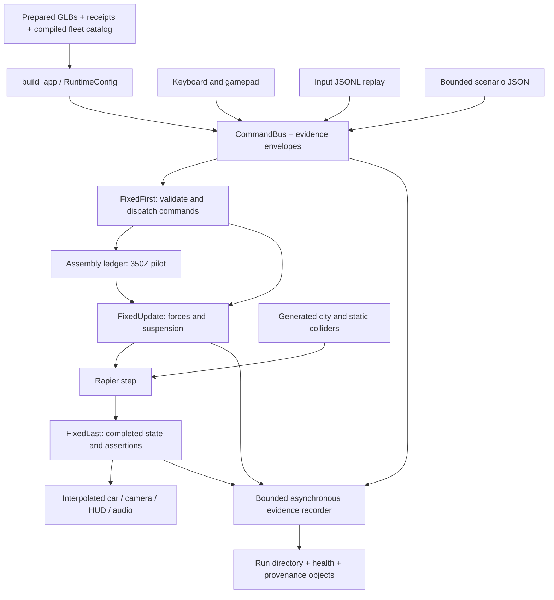

# Architectural and data map

Inspected 2026-10-23 at source commit `2342545363c225929963d16b5a05ca26e0ca2798`.
Scope: this checkout, its tracked JSON, prepared GLBs, Rust runtime, Python tools, tests and architectural decisions. No persistent SQL database was found in the tracked inventory. The SQL below was executed against temporary in-memory SQLite tables populated from the JSON and GLB inspections; these are analytical views, not application tables. Machine-readable query text, results and inventory counts are retained in [architecture-inventory.json](architecture-inventory.json).

## What exists and how it runs

This is a Rust 2024 free-drive simulation. Bevy owns the application/ECS, scheduling, assets, rendering and input; Rapier owns rigid-body integration and contacts. Cars share authored arcade tuning and differ in prepared art, wheel geometry and chassis dimensions. The 350Z additionally has a major-part assembly pilot. Sources: [Cargo.toml](../../Cargo.toml), [ADR 1](../adr/0001-bevy-rapier-vehicle-dynamics.md), [ADR 3](../adr/0003-prepare-a-selectable-fleet.md), [vehicle.rs](../../src/vehicle.rs).



`main` creates the recorder, parses config, installs shutdown handling and invokes the single production builder. Window, offscreen and render-disabled backends share runtime, assembly, vehicle and city plugins. Rendering disabled still runs the actual simulation. Sources: [main.rs](../../src/main.rs), [lib.rs](../../src/lib.rs#L26).

The schedule is `FixedFirst` (begin tick, scenario/replay ingress, dispatch) → `FixedUpdate` (assembly projection, force computation, Rapier) → `FixedLast` (completed clock, observations, assertions). Physics uses 1/120 s. Update handles devices and presentation, and can process pause/resume while virtual time is paused. The city is generated from grid formulas rather than loaded road/building tables. Sources: [runtime.rs](../../src/runtime.rs#L178), [vehicle.rs](../../src/vehicle.rs#L74), [scenario runner](../../src/scenario/runner.rs#L37), [city.rs](../../src/city.rs#L65).

## Logical entities and relationships

| Entity / source | Grain and identity | Relationships and constraints |
|---|---|---|
| Fleet catalog: `assets/cars/roster.json` | One selectable car per `id`; array position defines selection order | `path` references a prepared GLB under assets; sibling `.json` is its receipt. `game_id` groups source games. Geometry drives rendering and physics. |
| Preparation receipt: `assets/cars/<id>.json` | One receipt per prepared edition | `prepared_sha256` binds exact GLB bytes; `source` and `source_sha256` identify upstream art. Fleet receipts map source nodes to prepared nodes. Baseline receipt has another shape. |
| GLB scene | Scene → nodes → meshes → primitives → accessors/materials | Node/mesh indices are local to that asset and version. Fleet source/prepared node correspondence lives in receipt `mesh_nodes`; names alone do not establish mechanical identity. |
| Assembly | One `vehicle`, `owner`, `revision` | Definitions keyed by DefinitionId; Parts keyed logically by PartId; each Part references one Definition and exactly one Attachment. |
| Definition and Mount | Reusable definition; named mounts within definition | Definition contains mass, center, inertia, collision/visual binding. Mount has interface, frame, required flag and optional wheel corner. |
| Part and Attachment | Owned instance with condition and secured state | Root is a vehicle or inventory slot; Mounted references parent PartId plus parent mount name. Parent tree must terminate without cycles; mount and inventory occupancy are exclusive. |
| Prerequisites and Networks | Edges between PartIds | Prerequisites are acyclic and constrain installed parts. Networks are separate links; validation checks endpoint existence, without imposing the attachment graph's acyclicity. |
| Transaction | TransactionId → expected revision, part, destination | Matching retry is idempotent; changed payload with reused ID is rejected; stale revision is rejected; staged validation precedes atomic in-memory commit. |
| Scenario | Schema v1, driving scene, initial state, commands, assertions, bounds | Initial car references fleet. Each scheduled command has exactly one tick or elapsed-ms trigger. Career context supplies owner and allowed car IDs. |
| Run manifest | One `run_id` per evidence directory | Parent of streams, reports, captures, recorder health, failures and provenance. |
| Command ingress | One submitted command with command_id | Join to effects by run_id + command_id; correlation_id links related evidence. One command can emit several events. |
| Event | One envelope with kind, fields, seq | Envelope carries tick, boundary, actor and optional part/transaction/result IDs. Event seq is distinct from internal recorder sequence. |
| Input / Physics | Effective input per simulation invocation; ordinary physics sample per car step | Files inherit run identity from directory. Physics includes car, actor, tick, pose, velocities, wheel support and embedded input. See boundary rules below. |
| Provenance entry | Logical path + role → SHA-256 object | Multiple logical entries may reuse identical content. Object bytes live at `objects/sha256/<digest>`; capture/index bind configuration, binary, assets and evidence. |

Schema authorities: [roster.rs](../../src/roster.rs), [assembly.rs](../../src/assembly.rs), [assembly mass](../../src/assembly/mass.rs), [scenario.rs](../../src/scenario.rs), [telemetry.rs](../../src/telemetry.rs), [diagnostics samples](../../src/diagnostics.rs#L623), [provenance store](../../src/provenance/store.rs).

The Assembly is serializable and stable IDs exclude ECS Entity values, but the inspected production path initializes a fresh pilot in PostStartup; it does not implement save-game restoration. `AssemblyRuntime.bodies` is a derived VehicleId → Entity map. Career access is an explicit supplied context, not a discovered account/ownership database. Sources: [assembly runtime](../../src/assembly/runtime.rs), [config.rs](../../src/config.rs#L20).

## Executed exploration

All 26 tracked JSON files parsed successfully. There are 13 unique fleet IDs, 13 corresponding GLBs and receipts, totaling 26,695,748 GLB bytes. Direct SHA-256 equality checks matched all 13 receipts. Named wheel/tire node counts matched all catalog expectations. No duplicate IDs or missing edition joins were observed. This establishes local structural consistency, not visual acceptance or upstream preservation.

The in-memory query relations were `cars(id, game_id, path, wheel_nodes, triangles, wheelbase)` and `editions(car_id, actual_sha, receipt_sha, glb_wheel_nodes, receipt_shape, bytes)`.

```sql
SELECT c.id
FROM cars c LEFT JOIN editions e ON c.id = e.car_id
WHERE e.car_id IS NULL
   OR e.actual_sha <> e.receipt_sha
   OR c.wheel_nodes <> e.glb_wheel_nodes;
-- 0 rows

SELECT game_id, COUNT(*) FROM cars GROUP BY game_id;
-- GT4: 3; each of five other games: 2

SELECT receipt_shape, COUNT(*) FROM editions GROUP BY receipt_shape;
-- baseline: 1; fleet: 12
```

Catalog wheelbase ranges from 2.33 to 2.729 m; declared triangle counts range from 528 (GT RX-7) to 115,637 (MCLA Skyline). Triangle counts here are catalog values, not a fresh geometric-preservation proof. GT4 has three cars because it includes the baseline; “two per game” refers to additions. See the [query results](architecture-inventory.json).

## Edge cases and conventions that change analysis

1. **Tick, step, and row number are different.** Physics samples are assembled before the Rapier step; `simulation.completed` events describe the completed state afterward. Reset writes input and `vehicle.reset`, then skips ordinary physics sampling. Trace step advances only on a physics record, so input step values can repeat across resets. Join current streams by run directory/run_id and tick, preserving boundary and actor; do not require input ↔ physics one-to-one rows or deduplicate input by step. Legacy inputs default missing tick to zero and need a separate import path. Sources: [vehicle simulation](../../src/vehicle.rs#L164), [sample emission](../../src/vehicle.rs#L351), [completed state](../../src/runtime.rs#L223), [trace and input](../../src/diagnostics.rs#L590).
2. **A reset's successful effect is `vehicle.reset`.** It does not use the normal applied `command.outcome` path. A left join from commands to only command.outcome will falsely classify successful resets as unanswered. Count command outcomes separately from emitted legacy effect events to avoid double-counting other actions. Sources: [dispatch](../../src/runtime.rs#L291), [reset application](../../src/vehicle.rs#L187), [legacy effects](../../src/runtime.rs#L497).
3. **Reset count includes selections.** Switching cars increments reset_count, so it is not a crash or explicit-reset counter. Use event reasons and car-switch events. Source: [selection](../../src/runtime.rs#L406).
4. **Baseline wheel-node count is eight, others four.** The 350Z keeps distinct wheel and tire nodes; additions use four composite pivots. The baseline receipt also lacks fleet correspondence fields. Catalog fields such as triangles are analytical metadata absent from CarSpec; deserialization does not make every JSON field a runtime tuning parameter. Do not infer eight physical wheels or force all receipts through one undocumented shape. Sources: [roster](../../assets/cars/roster.json), [baseline receipt](../../assets/cars/350z.json), [fleet checker](../../tools/check_assets.py).
5. **Catalog is compiled into the binary.** Editing disk roster alone does not update CarSpec. Provenance compares embedded and runtime catalogs and records mismatch. Historical analysis must use captured catalog/receipts, rather than today's checkout. Sources: [Fleet default](../../src/roster.rs#L59), [provenance capture](../../src/provenance.rs#L26), [provenance conventions](provenance.md).
6. **Assembly is a 350Z pilot.** Other cars reject assembly commands and retain the baseline regression path. Five authored parts approximate a residual chassis and four wheels; asset node names do not prove an engine/fastener/mechanical topology. Prerequisites/networks are initially empty. Sources: [pilot](../../src/assembly/pilot.rs), [projection and command gate](../../src/assembly/runtime.rs), [mechanical inventory tool](../../tools/inventory_mechanical_assets.py).
7. **Recorded time has several meanings.** Scenario tick/ms triggers begin relative to readiness; wall deadlines include startup. Real elapsed-ms triggers work while paused. Ordinary input replay consumes rows in file order, not according to stored tick/time. Seed is recorded, but scenario metadata explicitly reports no random draws; changing seed is not evidence of a different city. Sources: [runner](../../src/scenario/runner.rs), [replay loader](../../src/diagnostics.rs#L684), [replay submission](../../src/runtime.rs#L528), [city formulas](../../src/city.rs).
8. **Metrics require explicit definitions.** Physics speed is signed forward velocity; scenario SpeedAtLeast uses 3D velocity magnitude. Car cycling tests the adjacent catalog entry for career ownership and may reject it instead of skipping to the next owned car. Sources: [vehicle speed](../../src/vehicle.rs#L217), [assertions](../../src/scenario/runner.rs#L270), [cycle/access](../../src/runtime.rs#L310).
9. **Healthy-looking JSON is insufficient evidence.** The bounded writer may drop records under pressure; health records losses and written/flushed/synced progress. Check health before interpreting absence of events. Incident history is bounded, so a failure tail is not the complete run. Provenance integrity and behavioral success are separate checks. Sources: [recording](../../src/diagnostics/recording.rs), [history](../../src/diagnostics/history.rs), [writer](../../src/diagnostics/writer.rs), [run verifier](../../tools/verify_run.py), [provenance](provenance.md).
10. **Verification docs contain historical claims.** README's 18 Rust tests and retained historical inventories are not current execution results. This checkout initially had no artifacts directory and no sibling carmodels archive; source-preservation and GPU acceptance were not independently established in this exploration. The baseline check tolerates absent originals, but full fleet preservation checks require them. Sources: [README](../../README.md), [asset checker](../../tools/check_assets.py).

## Highest-leverage questions

| Priority | Question and decision supported | Evidence / feasible next query |
|---|---|---|
| 1 | Which geometry is hardest to drive reliably under identical inputs? Helps target suspension/collider work. | Generate matched per-car scenarios; aggregate grounded wheels, loads, slip, turning, braking and reset reasons by car and configuration hash. Assets alone cannot answer this. |
| 2 | Do renderer/cadence changes alter completed trajectories? Protects the central shared-simulation contract. | Replay identical inputs with identical captured configuration/assets across backends; compare completed-state events at matched ticks with defined tolerances. Current trace provenance does not prove cross-platform determinism. |
| 3 | Where are commands delayed or rejected? Helps separate control UX from physics failures. | commands LEFT JOIN effects on run_id + command_id, including vehicle.reset; group by action, source, disposition and reason; preserve pause time and ingress/effect boundary. |
| 4 | What changes when a wheel is detached or mass moves? Guides the next assembly milestone. | 350Z transaction scenarios; compare revision, readiness, mass/inertia, wheel mask and subsequent completed trajectories. Extension to other cars requires authored definitions. |
| 5 | Which runs are trustworthy enough for performance comparisons? Avoids false regressions. | Filter by recorder health, mode/backend, completeness, binary/config/asset identities and capture validation. Inspect source-build mismatches and loss ranges before aggregating. |
| 6 | Where does asset detail increase cost without improving acceptance? Helps prioritize asset optimization. | Join catalog triangles/GLB bytes to per-car capture/frame reports within comparable offscreen/window configurations. Current inventory supplies sizes, but no fresh performance measurements. |
| 7 | Are apparent missing rows or reset spikes real failures? Improves diagnostic accuracy. | Account for reset sampling gaps, repeated legacy steps, selections, partial shutdown, and recorder losses before classifying anomalies. |

These are engineering questions. The inspected data does not establish player retention, real vehicle performance, a durable ownership economy, or complete mechanical coverage.

## Verification of this exploration

- Completed: tracked-file inspection, JSON parsing, direct GLB hash/receipt equality, GLB node count and header checks, self-contained buffer/image reference checks, four-corner catalog ordering, in-memory SQL joins and aggregates, and resolution of every local source link in this report.
- Three supplied scenario fixtures were inspected (assembly-wheel, driving-reset, pause-selection-career); their declared command/assertion counts are 4/4, 3/3 and 5/4 respectively.
- Passed: `cargo fmt --check`, `cargo clippy --all-targets -- -D warnings`, `scripts/check_codelimit.sh HEAD` (no changed Rust/Python files, so per-file complexity checks skipped), and `cargo test --all-targets`: **67 passed, zero failed** (19 library, 7 assembly, 21 recorder health, 4 shutdown, 16 scenario tests). The cold test build took 6m 19s; this is build time, not a simulation performance measurement. `git diff --check` also passed.
- No gameplay code, assets or tuning changed. Source originals and GPU/window behavior are outside the evidence obtained here.
- Jev verification tools were searched for but are unavailable in this session; claims were checked directly against the linked local sources and deterministic query output.
