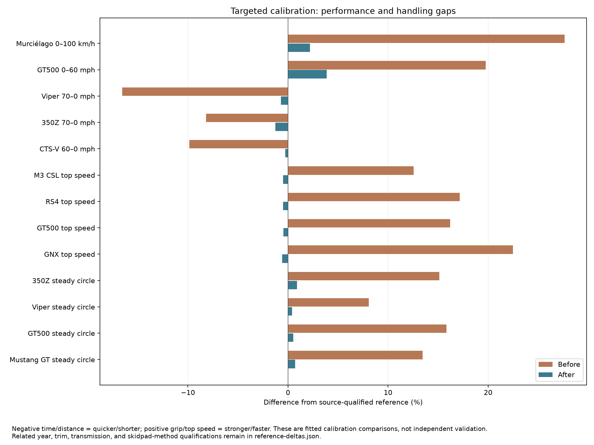
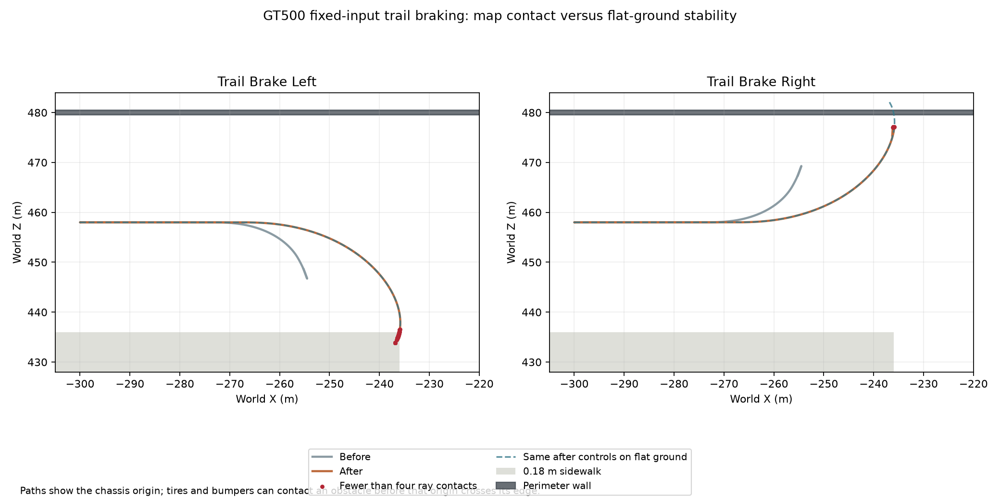
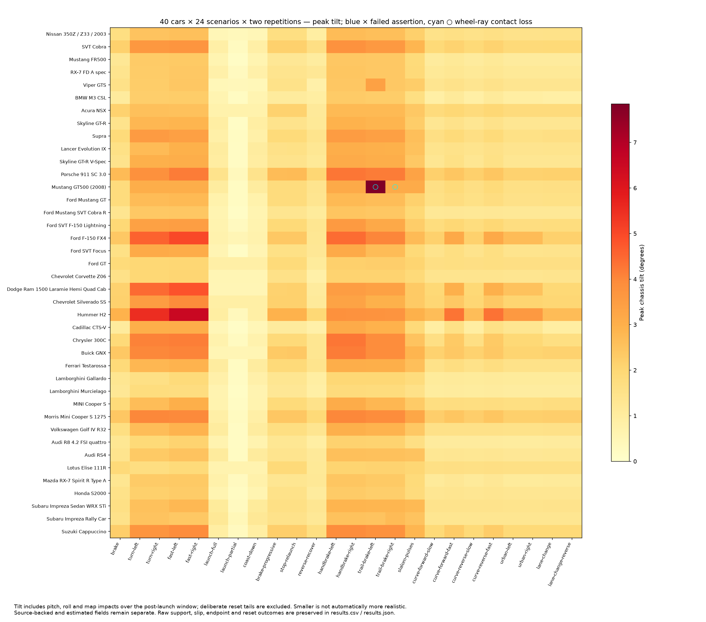
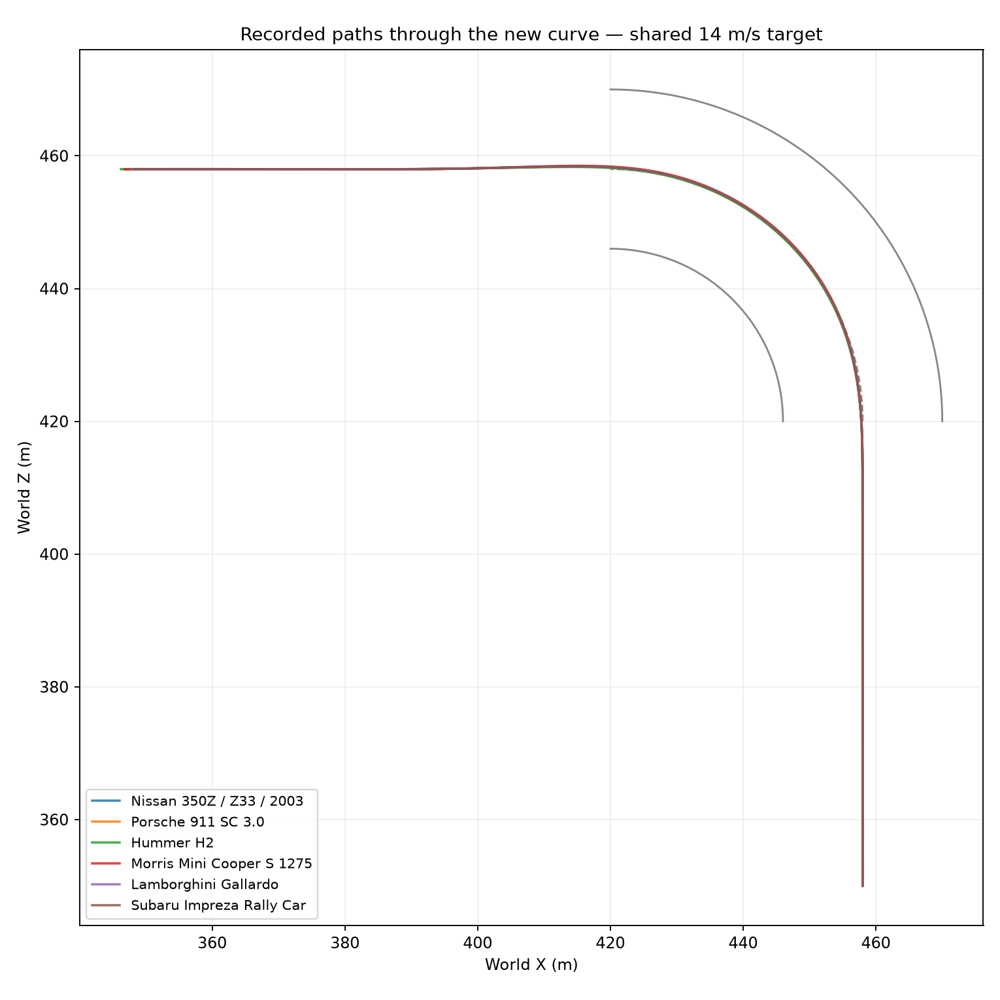

# 40-car reference comparison and physics calibration

The comparison identifies three supported problems: one friction coefficient coupled launch traction to excessive cornering grip; several effective brake-force budgets stopped too quickly; and the runtime omitted electronic speed governors. The Murciélago also had an unsupported reduction estimate and an aero/engine envelope that did not reproduce its published acceleration and high-speed claims together.

The fixes change **17 physical parameter values across nine profiles**, add separate lateral grip limits and source-qualified governors, and preserve all 40 models, wheel geometry, city geometry and scenario definitions. The final **40 × 24 × 2 = 1,920** recorded rerun completed: all 5,360 assertions and all 640 route completions passed, with no unexpected resets. All 81 Rust tests and the native 40-car/160-view check passed. Four fixed-input GT500 stress repeats contact city obstacles, as diagnosed below. Draft runs are not acceptance evidence.

[Validation receipt](validation.json) · [scenario summary](completion-summary.json) · [matched scenario deltas](scenario-deltas.json) · [All 40 before/after measurements](all-40-comparison.csv) · [qualified reference comparisons](reference-deltas.json) · [parameter changes](parameter-changes.json) · [before profiles](before-profiles.json) · [after profiles](after-profiles.json).



## Largest supported discrepancies and changes

| Measurement | Before | After | Real reference / qualification |
|---|---:|---:|---|
| Murciélago 0–100 km/h | 4.850 s | 3.883 s | 3.8 s manufacturer claim; [period dealer brochure](https://www.luxosonline.pt/empresas/catalogos/4_lamborghini_int_murcielago.pdf). |
| GT500 0–60 mph | 5.150 s | 4.467 s | 4.3 s, 2008 coupe; skilled launch and unspecified rollout. [Period test](https://www.motortrend.com/reviews/2008-dodge-challenger-srt8-vs-ford-shelby-gt500-comparison-test-archive). |
| Viper GTS 70–0 mph | 45.003 m | 53.575 m | 53.950 m, related 1997 GTS; native model year unresolved. [Period test](https://www.caranddriver.com/reviews/a35728264/1997-dodge-viper-gts-vs-porsche-911-turbo-s-vs-acura-nsx-t-comparison-test/). |
| 350Z 70–0 mph | 45.894 m | 49.352 m | 49.987 m, related Track equipment grade. [Period test](https://www.caranddriver.com/reviews/a15136959/nissan-350z-road-test/). |
| CTS-V 60–0 mph | 33.245 m | 36.777 m | 36.881 m, 2004 instrumented test. [Period comparison](https://www.motortrend.com/reviews/comparison-2004-cadillac-cts-v-vs-jaguar-s-type-r-archive). |
| 350Z steady-circle grip, 300 ft | 1.013 g | 0.888 g | 0.88 g, related Track grade. |
| GT500 steady-circle grip, 200 ft | 1.031 g | 0.895 g | 0.89 g average in the test; accessible source does not identify pad diameter. Both simulation diameters are retained. |
| Mustang GT steady-circle grip, 200 ft | 0.953 g | 0.846 g | 0.84 g, related automatic transmission test versus manual profile. [Period test](https://www.motortrend.com/reviews/2005-ford-mustang-gt). |
| Viper steady-circle grip, 300 ft | 1.027 g | 0.954 g | 0.95 g, related 1997 GTS. |
| M3 CSL top speed | 281.368 km/h | 248.782 km/h | Stock 250 km/h governor; 280 km/h license-qualified option excluded. [BMW](https://www.bmw-m.com/en/topics/magazine-article-pool/the-bmw-m3-csl.html). |
| RS4 top speed | 292.911 km/h | 248.753 km/h | Standard B7 250 km/h governor, qualified European reference; optional 280 km/h package excluded. [Audi retrospective, p.19](https://www.ausmotive.com/downloads/Audi/RS4-Avant-press-kit-June2012.pdf). |
| GT500 top speed | 289.858 km/h | 248.317 km/h | Nominal 155 mph / 249.448 km/h; related 2007 stock-family observation. [Period drive](https://www.motortrend.com/features/2007-ford-shelby-gt500). |
| GNX top speed | 244.456 km/h | 198.405 km/h | 124 mph / 199.559 km/h fuel cut reported on the period prototype. Retained as a qualified controller proxy. [Period test](https://www.caranddriver.com/reviews/a33502193/tested-1987-buick-gnx/). |

Numerical precision preserves calculations; it does not imply that the road tests or estimates were measured to those decimal places. These are calibration comparisons, not independent validation. Published claims, instrumented observations, related trims, and prototype measurements remain distinct.

## Physics causes

**Combined tire forces.** The former circular limit used `tire_mu` for both longitudinal and lateral force. The GT500 was launch-grip limited while its lateral grip already exceeded the reference. Increasing that one coefficient would worsen cornering. The runtime now limits utilization through an ellipse:

`(Fx / (load × longitudinal_mu))² + (Fy / (load × lateral_mu))² ≤ 1`.

When both coefficients are equal, the original circular implementation remains the exact path. A neutral refactor reproduced every original longitudinal measurement for all 40 cars. Four calibrated lateral limits are separate from longitudinal grip. The GT500's estimated longitudinal peak is 1.25, while its lateral limit is 0.935; neither is asserted to be a measured tire coefficient. The regression first failed by allowing 1,250 N of lateral force where the selected envelope allows 900 N, then passed with the ellipse.

**Brakes.** Effective deceleration budgets were based on estimated peak tire friction rather than source-qualified stopping observations. Load-following brake allocation and the tire envelope remain; the Viper, 350Z, GT500 and CTS-V receive separate calibrated service-brake budgets. These are effective force budgets, not recovered caliper torques, hydraulic pressures or exact ABS algorithms.

**Murciélago gearing, losses and aero.** The original estimated final multiplier, 2.53, matches the *reverse gear* number in the factory dossier and allowed first gear to run to approximately 128 km/h. The dossier publishes transmission ratios but does not establish the final multiplier used here. The replacement effective reduction of 3.3 remains an estimate. It is calibrated jointly with an 8,000 rpm operating ceiling, 0.82 effective driveline efficiency, and 0.66 m² drag area. The [factory dossier](https://www.lamborghiniclubwest.com/murcielago.pdf) gives a drag-coefficient range; the 2.0 m² frontal-area projection used with its low-drag 0.33 value is estimated. These inputs are not presented as recovered OEM gearing, measured frontal area, measured losses or a recovered wing/intake controller.

The resulting 329.891 km/h is close to the published over-330 km/h claim but **does not strictly meet that lower bound**. The residual is retained rather than rounded into a passing bound. Crankshaft peak power and peak torque were not increased.

**Electronic governors.** The new optional profile field tapers propulsive torque across the final 0.5 m/s before the selected limit and supplies no engine force above it. It does not clamp velocity or introduce braking; coasting or downhill motion can exceed a governed speed. The four configured limits preserve source/year/market qualifications. Null entries mean no applicable governor was selected from evidence, not that the real vehicle is known to be unrestricted. A regression reproduced 2,689 N of M3 propulsive force at 270 km/h before the fix and zero afterward, while an ungoverned comparison car retains power.

## Coverage and measurement method

Every edition has before/after acceleration, standardized entry-speed braking, a 140-second full-throttle high-speed measurement, and both 200- and 300-ft-diameter steady-circle sweeps. There are 53 sourced performance comparison rows across 22 editions: 52 eligible with their stated qualifications, plus one excluded alternate-market comparison; four handling comparisons have useful reference data. Eighteen editions lack compatible quantitative performance references in this corpus. [Unfitted handling references](unfitted-handling.json) retain the GNX prototype comparison and Cobra R pad-protocol issue. Their measurements remain available without inventing targets.

The original 35 comparison rows' mean absolute percentage difference falls from 8.98% to 6.53%. This is descriptive across heterogeneous source claims/tests, not a fleet accuracy score or uncertainty estimate. Bounds are handled separately. The additional high-speed and handling evidence is retained alongside that original comparison set.

Flat fixtures use the production `VehiclePlugin`, 120 Hz steps, full throttle from rest without rollout, normal automatic shifting and unchanged nominal profile masses. Braking starts at the specified measured speed and stops the measurement below 0.1 m/s. Top-speed probes use a sufficiently large flat collider, record all-wheel support and final 10-second speed gain, and retain a finite-run peak rather than claiming an infinitely settled terminal speed. All 40 cars retain four contacts throughout both before/after high-speed sweeps.

The high-speed baseline is a frozen-source remeasurement reconstructed from the accepted baseline bundle, not a claim that those new metrics were collected by the original executable. The helper uses separate Cargo package identities and asserts exact equality of its embedded per-car profile metadata to its frozen inputs. It reproduces every original longitudinal measurement exactly. [Helper source](envelope-benchmark.rs) · [method and source guards](envelope-method.json).

The circle driver supplies steering, throttle and brake inputs through the production force model; it injects no lateral force or yaw torque. Target lateral acceleration rises slowly after warm-up. Reported grip is the highest one-second mean `speed × yaw-rate / g` window with four contacts, radial error below 1 m and speed error below 0.5 m/s. These are left-turn, controller-driven comparisons, not exact reproductions of each publication's human-driven CW/CCW protocol. Both after cohorts repeat identically for all 80 sweeps, as do both 40-car longitudinal and high-speed measurement sets.

## Remaining discrepancies and source risks

- The GNX's 300-ft sweep remains at 0.937 g versus the prototype's 0.80 g, an approximately 17% difference. That remains an unfitted candidate until production tires, chassis setup and test conditions are matched. Its reported fuel-cut behavior does not establish traction equivalence.
- The GNX still takes 6.017 s to reach 60 mph versus 4.7 s in the prototype test. That test used different engine-output figures. Production output is retained, and the simplified driveline lacks a recovered torque-converter/boost model; the engine is not boosted to force a prototype time.
- The 911's 5.650 s to 100 km/h remains below the qualified 6.8 s listing claim. Its market, loading and launch method are insufficiently matched to justify reducing engine output. M3 CSL and RS4 acceleration also remains quicker than their manufacturer/adjacent-market claims; this is not resolved by their correct speed governors.
- Not every secondary metric improves: GT500 0–100 mph changes from 9.967 to 9.275 s against the same period test's 9.7 s. This was not a fitting target; its absolute difference rises from 2.7% to 4.4%. The earlier weak launch was partly masking a faster midrange. Matched torque curves, rotating inertia, test load and shift data are better next evidence than another arbitrary power reduction.
- The R32's alternate US 130-mph top-speed reference is ineligible for the selected European GT4 identity. Applying that governor would introduce a market mismatch.
- [Geometry review](geometry-review.json) preserves real wheelbase comparisons separately from art pivots. The 911 differs by +2.55%, Hummer +3.03%, CTS-V +4.51%, and Testarossa −3.92%. Truck cab/bed ambiguity produces larger apparent differences. Meshes and pivots are preserved; an uncertain truck configuration is not silently stretched to another cab's dimensions.
- CG height, inertia, spring/damper behavior and most tire/differential inputs remain estimates. No matched real roll-gradient target exists here, so peak tilt alone is not treated as a real-world handling score. WRC data remains a provisional dry-tarmac setup.

## Fixed-input GT500 surface contacts

The two GT500 trail-brake cases, each repeated twice, briefly lose wheel-ray contacts in the city. Their four-contact fractions are 92.866% left and 97.503% right, versus 100% before. They have no all-wheels-airborne tick and no unexpected reset. They enter steering at 21.032 m/s versus 17.262 m/s before, with different combined braking and cornering limits, so the same timed controls follow a longer/wider path.

A controlled environment counterfactual uses the frozen production `VehiclePlugin` and exactly those authored Drive controls. On flat ground, both directions retain four contacts throughout and peak at 3.118° tilt. Adding only the city's nearby 0.18 m raised sidewalk block and perimeter wall reproduces **both city contact percentages exactly**, and the left case's 7.842° peak tilt. The left trajectory traverses the sidewalk corner near X=−236, Z=436; the right front reaches the wall face at Z=479.5 before the chassis origin does.

This isolates the observed contact loss to map interaction under the fixed timing, rather than a loss of flat-ground support in the tire model. It does not validate real curb-impact or damage dynamics. The original case assertions and inputs remain unchanged: passing displacement/identity/reset assertions does not imply a contact-free path. Brake-hold retains the game's brake-to-reverse convention after near-stop. Closed-loop route outcomes are reported separately.



[Controlled comparison and collider dimensions](trail-surface-proof.json) · [counterfactual helper](trail-surface-benchmark.rs). No geometry or physics was changed to erase these outcomes.

## Final recorded results

- All 1,920 runs exit successfully with healthy recording; all 5,360 declared assertions execute and pass.
- All 640 closed-loop routes reach their endpoints within the unchanged 7 m corridor, with four wheel-ray contacts throughout. Maximum cross-track error is 3.790 m.
- No unexpected resets occur. The 80 requested resets belong to the original braking protocol.
- All 960 car/case pairs have identical sampled trajectory hashes between repetitions on this build/platform.
- All 1,488 runs belonging to the 31 profiles with unchanged physical values also have identical trajectory hashes to their matched baseline runs.
- The four GT500 trail-brake stress repeats are the only cases below 100% four-contact support; the lowest fraction is 92.866%. Minimum four-loaded-wheel fraction across the entire study is 89.655%, which includes those map interactions. Ray contact and nonzero tire load are distinct.
- All 1,920 evidence bundles pass build/source/runtime-material verification. This does not establish complete cross-platform replay.





The native run is `artifacts/runs/20261024T182954585625Z-2342545-fleet-26919-1-1792866594611347000`, with 40 successful car scripts and 160 verified captures. All 40 models were visually checked in the five overview pages. [Verification log](../../../artifacts/vehicle-reference/fleet-40-calibration/verification.log) · [trace/evidence audit](evidence-audit.jsonl). The single recorded after binary is `1ba35ad568f41b2554280240ba8ee9250af940609b83f33a9ffd4f1f7644f0aa`.

## Same-scenario rerun

The accepted baseline is `artifacts/fleet40-final-20261024/selected-runs.jsonl`. The final after cohort is `artifacts/fleet40-calibrated-v2-20261024`. [Protocol equality](protocol-equality.json) verifies all 1,920 scenario byte hashes and car/case/repetition identities, plus unchanged roster, courses, seed, fixed rate and clock mode. Recorder queues use explicit 32 MiB / 32,768-record limits to avoid the earlier cohort's recording backpressure; these observer settings do not alter physics or controls.

The initial partial calibration cohort is retained at `artifacts/fleet40-calibrated-20261024`, with a draft-status receipt. It was stopped to add the high-speed governor checks before final acceptance. Its native run and partial index are not counted. An invalid exploratory shared-target probe is also retained under an explicitly invalid filename; the accepted frozen-source helper has distinct package identities and embedded-profile guards.

## Reproduce

The recorded scenario rerun requires the matching source/profile hashes. From the repository root:

```sh
CAR_GAME_MUTE=1 bash scripts/verify.sh --recorded --base HEAD
python3 tools/run_fleet40_study.py --output artifacts/fleet40-calibration-new \
  --binary target/release/car-game.recorded --repeats 2 --workers 4 \
  --recorder-queue-bytes 33554432 --recorder-queue-records 32768
python3 tools/audit_fleet40_evidence.py artifacts/fleet40-calibration-new \
  --output artifacts/fleet40-calibration-new/evidence-audit.jsonl
python3 tools/analyze_fleet40_study.py artifacts/fleet40-calibration-new \
  --output artifacts/fleet40-calibration-new/analysis
cargo run --example fleet_benchmark
cargo run --example fleet_skidpad
python3 tools/compare_fleet40_calibration.py
```

The reference comparison command consumes the frozen before/after measurements in `artifacts/vehicle-reference/fleet-40-calibration`; it does not treat a newly tuned profile as an old measurement. The baseline bundle, helper source and metadata guards document how the additional frozen-source measurements were produced.
