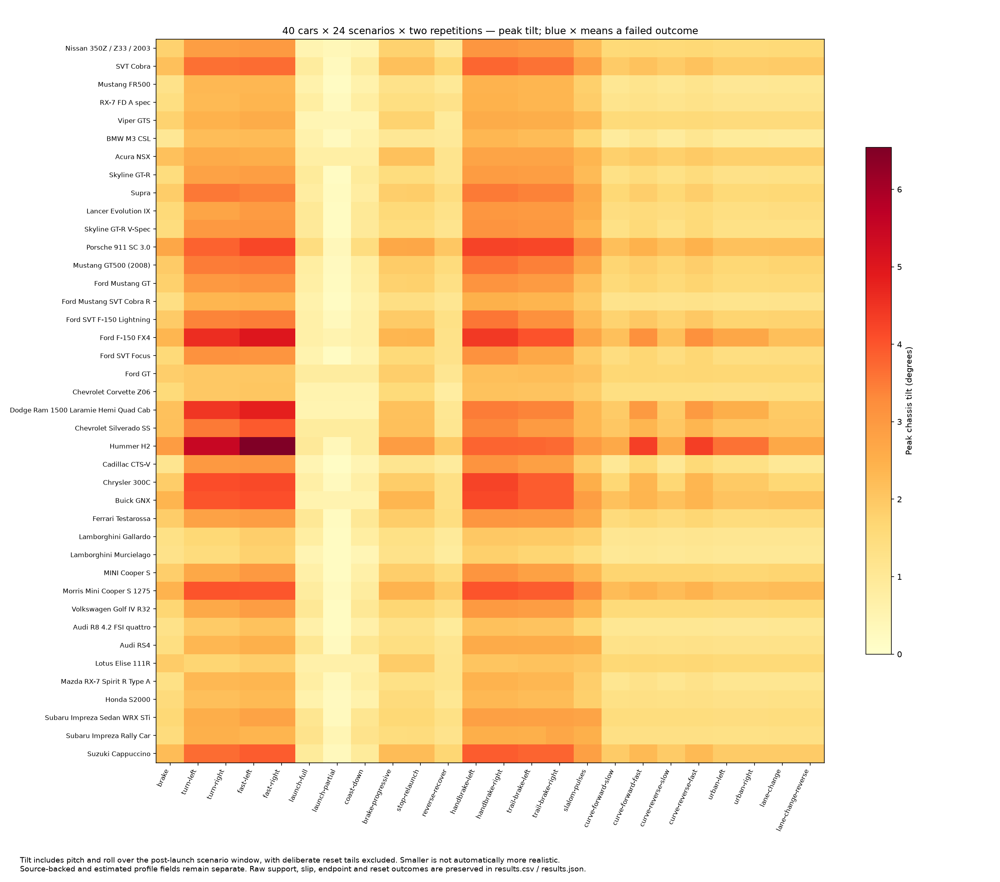
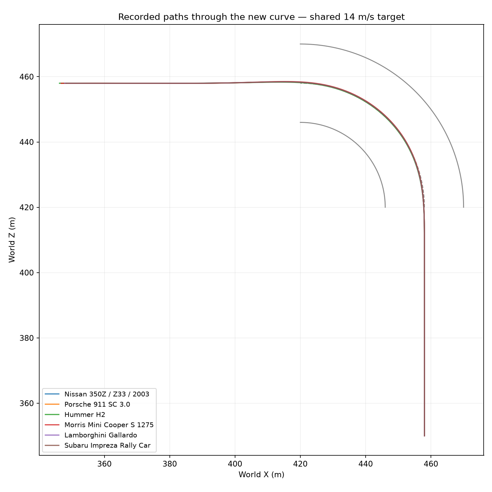
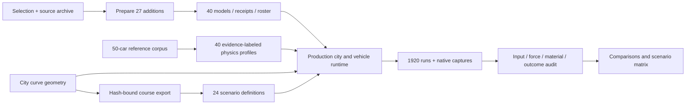
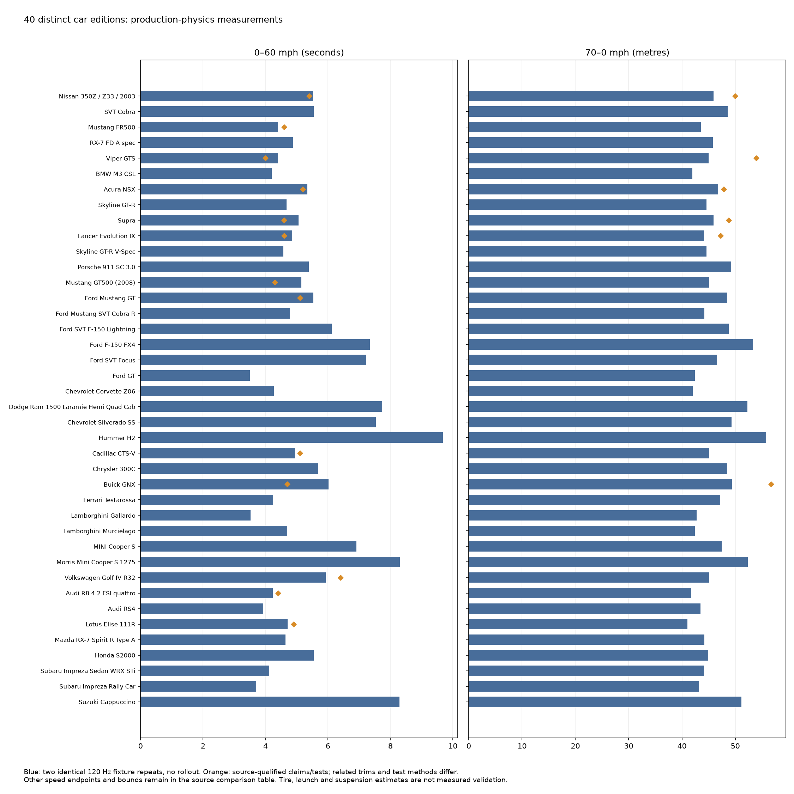

# 40-car fleet and expanded city scenarios

The fleet contains 40 prepared car editions: the original 13 plus 27 selected from the 50-car reference corpus. The original editions' models, receipts and physical parameters are preserved; the engine now also supports the new FWD profiles.

The expanded protocol completed **24 cases per car × 40 cars × two repetitions = 1,920 successful runs**, including 640 checkpoint-route completions. All 5,360 declared assertions passed. The native GPU fleet check separately passed all 40 car scripts and 160 views. [Results JSON](results.json) · [aggregate CSV](results.csv) · [completion summary](completion-summary.json) · [validation receipt](validation.json).

## Results

- No unexpected resets occurred. The 80 requested reset events belong to the original braking protocol.
- Every analyzed sample retained four wheel ray contacts. The lowest fraction with all four wheels carrying more than 1 N was 98.335% (Testarossa, trail-brake-left); ray contact does not imply a loaded tire or prove realistic grip.
- All 640 route runs reached their endpoint and passed their 7 m corridor requirement. Maximum cross-track error was 3.790 m. Each curve was completed in both directions at both target speeds by every car.
- All 960 car/case pairs produced identical sampled trajectory hashes across their two repetitions on this build/platform. This is local repeatability evidence; complete cross-platform replay is not established.
- Vehicle differences are visible: the Hummer peaks at 6.539° chassis tilt in fast-left. Its fast forward curve peaks at 4.316°, compared with lower sports-car values. Tilt includes pitch and roll; smaller values alone do not establish realism.
- In the separate flat-fixture benchmark, 0–60 mph is 3.525 s for the Gallardo, 3.708 s for the WRC car, 8.300 s for the classic Mini and 9.675 s for the Hummer. Both full 40-car fixture exports are byte-identical. Only 19 editions have compatible sourced comparison metrics (35 comparisons), so these measurements do not establish real-world accuracy for all 40.





### Recording retries

The matrix required **1,924 attempts**: four original attempts aborted on bounded recorder queue backpressure, then passed retries with recording queue limits raised from 8 to 32 MiB and from 8,192 to 32,768 records. The same executable, original scenario bytes, seed, physics parameters and control protocol were retained. None had reached a failed scenario assertion; their recorder health identifies queue-limit errors. Original attempts remain in `artifacts/fleet40-final-20261024/runs.jsonl`; the explicit `selected-runs.jsonl` selects exactly one successful attempt for every identity. [Selection policy](../../../artifacts/fleet40-retries-20261024/selection-policy.json) · [selected evidence audit](selected-evidence-audit.json). The raw runner exits nonzero because it truthfully retains those four failed attempts. Draft runs are not acceptance evidence.

## Inputs

- [Selection](selection.json), [preparation hashes](preparation.json), [profile research](profile-research.md), [27 added profiles](profile-expansion.json).
- [Original roster](original-roster.json) and [original profiles](original-profiles.json) preserve the pre-expansion inputs.
- [Courses exported from production city geometry](courses.json). The export carries the city curve source hash; the study refuses stale exports.
- [40-car reference comparisons](reference-comparison.csv) and [measurements and source qualifications](reference-comparison.json): 35 compatible metric definitions across 19 editions, with manufacturer claims and related market/year/transmission tests still labeled.

## Data and runtime map





The original 13 editions also match their prior 130 scenarios by model hash, parameter values, scenario bytes and effective inputs. Recomputed differences are within floating-point tolerance: maximum braking-distance difference about 0.0000062 m and heading-response difference about 0.000055°. These are numerical regression comparisons, not claims of real-world measurement precision. [Detailed original-fleet comparison](original-13-comparison.json).

## Scenario coverage

The five original braking/turning inputs remain available. Added cases cover full and partial launches, coast-down, progressive braking, brake-hold/relaunch, reverse recovery, handbrake turns in both directions, trail braking in both directions and alternating slalom inputs. Eight checkpoint scenarios cover the new curve in both directions at 8 and 14 m/s, urban corners in both directions, and lane changes in both directions.

Checkpoint cases use the same pure-pursuit controller and speed-feedback gains for every edition. It submits actual production `Drive` commands through the command bus. Completion requires reaching the route endpoint and staying within the declared corridor; matching car identity alone cannot pass a route. Open-loop cases use identical scheduled controls per car; closed-loop cases share the route, speed target and controller rather than identical resulting controls.

The initial pilot caught final-stop overshoot: the controller released service braking below 1 m/s, allowing several metres of low-speed coasting. A stricter production regression failed, then passed with the controller applying the parking brake after arrival. All 28 revised pilot runs across a 350Z, Hummer, classic Mini and WRC car passed. Physics coefficients and route tolerances were not changed to hide that failure.

Brake-hold cases retain the game’s shared brake-to-reverse input convention. A first near-stop and later reverse movement are distinct outcomes; holding that control is not asserted to maintain a parked state. Route completion uses the parking brake for the final stop.

## Curved road

The city previously contained straight grid streets and a rectangular perimeter. The northeast connector adds a 90-degree curve centered at world X/Z `(420, 420)`, with 38 m centerline radius and 24 m marked width. It joins the perimeter approaches near `(458, 420)` and `(420, 458)`. Solid segmented curbs bound it, and the continuous production asphalt collider supports the road without seams. All checkpoint routes are exported from the same Rust geometry used to build the city.

## Evidence and timing

The accelerated mode advances the normal production fixed-step simulation at 120 Hz while removing wall-clock waiting. It is restricted to render-disabled, tick-scheduled scenarios. Native rendering remains a separate real-time GPU check. Clock mode is explicitly retained in captured arguments and effective settings.

The native fleet check uses the recorder’s existing bounded 1 GiB finalization option: its 160 captures and traces exceed the earlier 512 MiB default. The recorder’s global limits are unchanged. [Measured sizing decision](native-output-budget.json).

The runner retains every scenario, command, effective input, physics trace, outcome and source/build bundle. Immutable content-addressed objects may share read-only hardlinks after hash validation, while each run keeps a complete independently verifiable bundle namespace. This reduces duplication of the executable and 40 model assets without deleting failed runs or reducing trace coverage.

Drafts are retained under `artifacts/fleet40-pilot-20261024`, `artifacts/fleet40-pilot-fixed-20261024`, `artifacts/fleet40-study-20261024` and `artifacts/fleet40-accepted-20261024`. The final cohort is `artifacts/fleet40-final-20261024`. Early batches were stopped to fix clock-mode provenance filtering and move selection planning data outside runtime assets. No draft is counted toward final acceptance.

The rendered curve was also driven in a separate native scenario: both assertions passed, with maximum cross-track error 0.356 m and no resets. [Native capture](curve-native.png) · [complete evidence](curve-native-evidence.json). The first preview reached its driving assertions but exhausted its tick budget before asynchronous screenshot completion; the successful preview adds capture headroom only. Existing grid markings continue through the connector intersection.

The native fleet's five overview pages were visually inspected for all 40 models. Driving captures were additionally inspected for the Hummer, classic Mini and WRC car. Source-era material and texture limitations remain visible; this work preserves the archived models rather than reconstructing their original game shaders.

## Fleet editions

| Runtime ID | Car | Model source | Drive |
|---|---|---|---|
| 350z | Nissan 350Z / Z33 / 2003 | Gran Turismo 4 | RWD |
| fr2-cobra | SVT Cobra | Ford Racing 2 | RWD |
| fr2-fr500 | Mustang FR500 | Ford Racing 2 | RWD |
| gt-rx7 | RX-7 FD A spec | Gran Turismo | RWD |
| gt-viper | Viper GTS | Gran Turismo | RWD |
| gt4-m3 | BMW M3 CSL | Gran Turismo 4 | RWD |
| gt4-nsx | Acura NSX | Gran Turismo 4 | RWD |
| mc3-skyline | Skyline GT-R | Midnight Club 3 Remix | AWD |
| mc3-supra | Supra | Midnight Club 3 Remix | RWD |
| mcla-evo | Lancer Evolution IX | Midnight Club: Los Angeles | AWD |
| mcla-skyline | Skyline GT-R V-Spec | Midnight Club: Los Angeles | AWD |
| redline-911 | Porsche 911 SC 3.0 | Redline | RWD |
| redline-gt500 | Mustang GT500 (2008) | Redline | RWD |
| ref-a01 | Ford Mustang GT | Gran Turismo 4 | RWD |
| ref-a02 | Ford Mustang SVT Cobra R | Gran Turismo 4 | RWD |
| ref-a04 | Ford SVT F-150 Lightning | Gran Turismo 4 | RWD |
| ref-a05 | Ford F-150 FX4 | Ford Racing 2 | AWD |
| ref-a06 | Ford SVT Focus | Midnight Club: Los Angeles | FWD |
| ref-a07 | Ford GT | Gran Turismo 4 | RWD |
| ref-a09 | Chevrolet Corvette Z06 | Midnight Club: Los Angeles | RWD |
| ref-a11 | Dodge Ram 1500 Laramie Hemi Quad Cab | Gran Turismo 4 | AWD |
| ref-a12 | Chevrolet Silverado SS | Midnight Club 3 Remix | AWD |
| ref-a13 | Hummer H2 | Midnight Club 3 Remix | AWD |
| ref-a14 | Cadillac CTS-V | Midnight Club 3 Remix | RWD |
| ref-a15 | Chrysler 300C | Gran Turismo 4 | RWD |
| ref-a16 | Buick GNX | Gran Turismo 4 | RWD |
| ref-e02 | Ferrari Testarossa | Redline | RWD |
| ref-e03 | Lamborghini Gallardo | Midnight Club 3 Remix | AWD |
| ref-e04 | Lamborghini Murcielago | Midnight Club 3 Remix | AWD |
| ref-e08 | MINI Cooper S | Gran Turismo 4 | FWD |
| ref-e09 | Morris Mini Cooper S 1275 | Redline | FWD |
| ref-e10 | Volkswagen Golf IV R32 | Gran Turismo 4 | AWD |
| ref-e11 | Audi R8 4.2 FSI quattro | Midnight Club: Los Angeles | AWD |
| ref-e12 | Audi RS4 | Midnight Club: Los Angeles | AWD |
| ref-e13 | Lotus Elise 111R | Gran Turismo 4 | RWD |
| ref-j04 | Mazda RX-7 Spirit R Type A | Gran Turismo 4 | RWD |
| ref-j07 | Honda S2000 | Gran Turismo 4 | RWD |
| ref-j11 | Subaru Impreza Sedan WRX STi | Gran Turismo 4 | AWD |
| ref-j12 | Subaru Impreza Rally Car | Gran Turismo 4 | AWD |
| ref-j16 | Suzuki Cappuccino | Gran Turismo 4 | RWD |

## Verification

The required recorded verification ladder passed: format, strict all-target Clippy, complexity gates, all 77 Rust tests, Python syntax and tooling tests, asset verification, 40-car offscreen rendering, and captured fleet/run evidence verification. The accepted native run is `artifacts/runs/20261024T052538723463Z-2342545-fleet-5566-1-1792819538746836000`; full log: `artifacts/vehicle-reference/fleet-40-acceptance-verification.log`.

All 1,920 selected runs have complete build/source and runtime material, healthy recording, successful exits and passed scenario summaries. Analysis additionally checks exact case coverage, input ticks, applied profile metadata, actual driven axles, physics tick coverage, course hashes and outcome metrics. The final selected analysis is bound to its run-index hash. Physical build source matches the native build; the binary SHA-256 is `44e90fb6a0ad4421131229567d6858e6f424b14364d89b033725e7f9a2b98cf9`.

## Reproduce

From the repository root:

```sh
python3 tools/expand_fleet.py
cargo run --example fleet_courses > docs/verification/fleet-40/courses.json
CAR_GAME_MUTE=1 bash scripts/verify.sh --recorded --base HEAD
python3 tools/run_fleet40_study.py --output artifacts/fleet40-new \
  --binary target/release/car-game.recorded --workers 4 --repeats 2
python3 tools/audit_fleet40_evidence.py artifacts/fleet40-new \
  --output artifacts/fleet40-new/evidence-audit.jsonl
python3 tools/analyze_fleet40_study.py artifacts/fleet40-new \
  --output artifacts/fleet40-new/analysis
cargo run --example fleet_benchmark > artifacts/fleet40-benchmark-r1.json
target/debug/examples/fleet_benchmark > artifacts/fleet40-benchmark-r2.json
python3 tools/compare_fleet40_references.py --first artifacts/fleet40-benchmark-r1.json \
  --repeat artifacts/fleet40-benchmark-r2.json --output artifacts/fleet40-new/references
```

The new selection supersedes the fixed thirteen-car count in ADR-0003 while preserving its source-fidelity requirements. The added vehicle parameters follow ADR-0004: estimates, native game proxies, related variants and verified source facts remain distinct. WRC setup is explicitly provisional tarmac calibration; this batch introduces no loose-surface tire or recovered differential-control model.

To inspect this accepted cohort, use its explicit selected-attempt index:

```sh
python3 tools/analyze_fleet40_study.py artifacts/fleet40-final-20261024 \
  --index artifacts/fleet40-final-20261024/selected-runs.jsonl \
  --output docs/verification/fleet-40
```

The raw index includes four incomplete attempts and intentionally fails closed if analyzed as an entirely successful cohort. The selected index and retry policy preserve the distinction.
