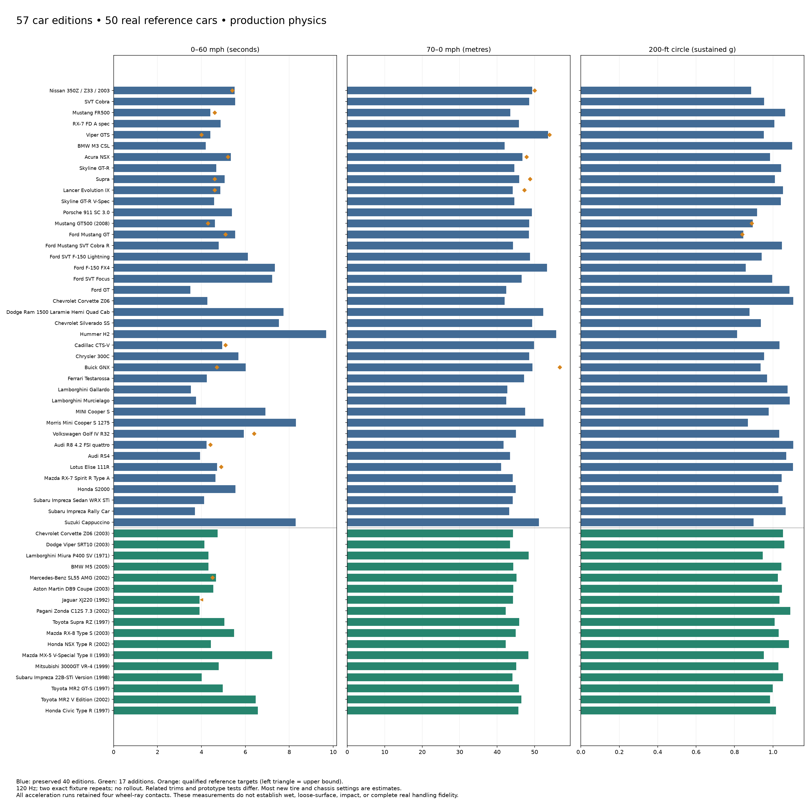
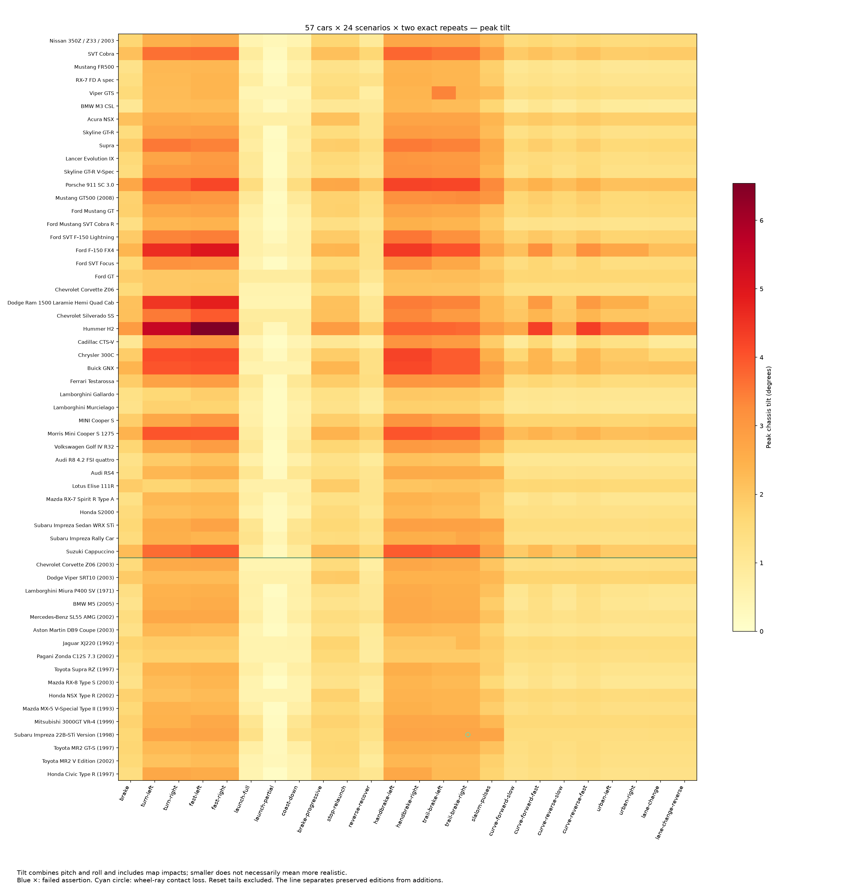
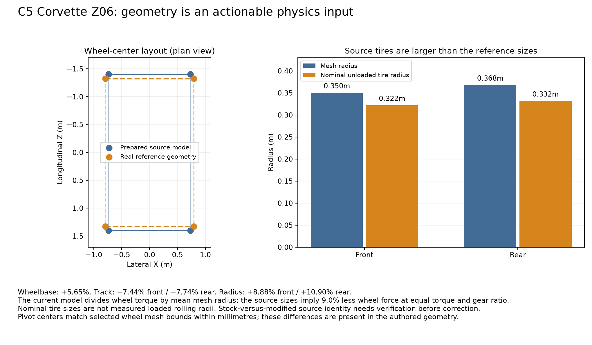
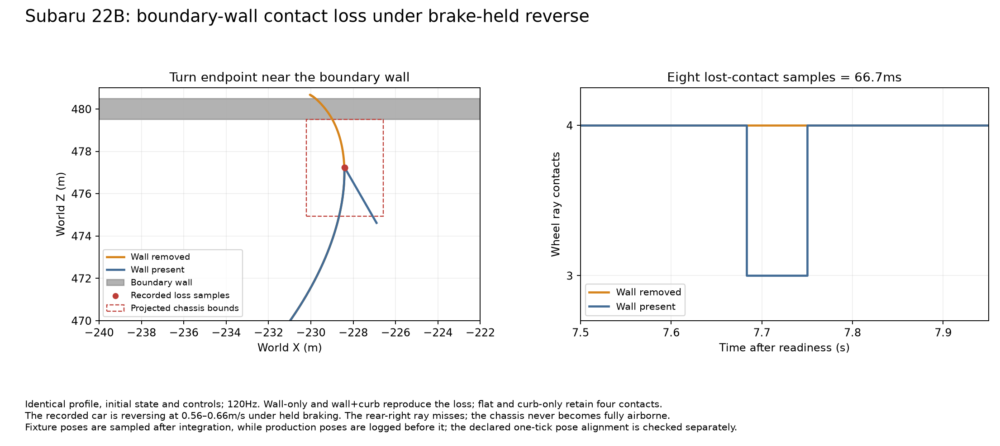
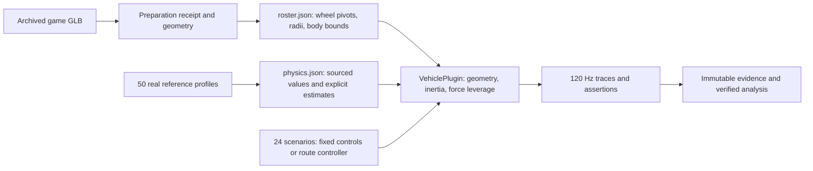

# Expanded fleet evaluation: 57 editions, all 50 real reference cars

Completed **2,736 new scenario executions**: 57 distinct archived models × all 24 existing cases × two independent processes, at 120 Hz and seed 17. All 40 previous editions and their physical parameters were preserved. The matrix represents 6,798,960 declared physics ticks (15.74 simulated hours).

**2,736/2,736 scenario passes**, 7,638 assertions, 912/912 route completions, 0 unexpected resets. 1368/1368 sampled trajectory repeat pairs are identical. 1920/1920 original-car trajectories match the prior accepted GT500 build, and their scenario file hashes match. All 40 prior straight-line benchmark rows and 80 circle rows are also unchanged. Two repeats at one fixed seed establish local repeatability, not multi-seed or multi-surface robustness.

## What the results establish

Every bundle passed content hashes, source/build binding, compiled-profile application, fixed-step/input coverage and recorder-health checks. Trajectory hashes cover post-launch relative tick, pose, linear velocity and ray-contact count; wall timestamps and run IDs are not compared as physical trajectories. 2,736 bundles have complete runtime material and rebuild inventories. Full portable replay is **not** claimed: runtime_replay_complete=False.

Minimum four-wheel ray contact across post-launch windows: **99.049%**. Minimum four-loaded-wheel fraction: **98.335%**. Largest route cross-track error: **3.790m**, against the existing 7m corridor. Brake reset tails are excluded from handling windows; 114 explicitly requested resets are retained. The braking reset intentionally has no vehicle-physics sample at relative tick1680; the analyzer checks and permits only that documented lifecycle gap. Input coverage remains complete.

The native acceptance run `artifacts/runs/20261025T014906737212Z-2342545-fleet-12341-1-1792892946761736000` checked all 57 drive scripts, wheel animations and 228 captured views. Its real-time frame measurements were taken under concurrent study load and are not a rendering-performance comparison.

The assertions test the driving contract: identity, movement, reset discipline and route completion. They do not establish real stopping distances, acceleration times, tire limits or crash behavior. Continuous measurements and qualified reference comparisons are evaluated separately.

## Biggest performance gaps

The corpus supports **40 qualified comparisons across 24/57 editions**. Absence of a comparison means missing applicable evidence, not a passed realism test. Related markets, transmission differences, prototype tests, manufacturer claims and strict upper bounds remain labeled in the CSV.

| Edition | Endpoint | Simulation | Reference | Difference | Qualification |
|---|---|---:|---:|---:|---|
| Buick GNX | zero_60_mph_s | 6.017 | 4.700 | +28.0% | related_prototype_test |
| Porsche 911 SC 3.0 | zero_100_kmh_s | 5.650 | 6.800 | -16.9% | manufacturer_hosted_dealer_claim_exact_year_and_engine |
| Audi RS4 | zero_100_kmh_s | 4.117 | 4.800 | -14.2% | related_reference |
| Buick GNX | brake_70_mph_0_m | 49.393 | 56.693 | -12.9% | related_prototype_test |
| Cadillac CTS-V | zero_100_mph_s | 10.917 | 12.300 | -11.2% | instrumented_test |
| Lotus Elise 111R | zero_100_mph_s | 11.558 | 13.000 | -11.1% | manufacturer_claim |
| BMW M3 CSL | zero_100_kmh_s | 4.367 | 4.900 | -10.9% | manufacturer_claim |
| Viper GTS | zero_60_mph_s | 4.400 | 4.000 | +10.0% | measured_related_year |
| Supra | zero_60_mph_s | 5.058 | 4.600 | +10.0% | measured_related_year_and_market |
| Nissan 350Z / Z33 / 2003 | zero_100_mph_s | 12.525 | 13.900 | -9.9% | measured_related_equipment_grade |

The GNX’s largest raw gap uses a **prototype** test against a production profile and should not be fitted as an exact production target. The 911’s 6.8s figure is a manufacturer-hosted dealer claim for the inferred European SC configuration. The RS4 target is an adjacent European reference. These are priorities to investigate, with their applicability limits intact.

Among the additions, the Zonda reaches 100km/h in 4.050s versus a 3.7s manufacturer claim (+9.5%). Its mass and gearbox remain estimates, so the result does not identify a unique tire or engine defect. M5: 4.483s versus 4.7s; SL55: 4.667s to 60mph versus 4.5s; DB9: 4.717s to 100km/h versus the related 2006 manual’s 4.9s. XJ220 reaches 60mph in 3.917s, satisfying the source’s under-4s bound.

All 57 acceleration fixtures retained four ray contacts. Ram, Hummer, classic Mini and Cappuccino did not reach 100mph within the 20s acceleration horizon; null endpoints are censored, not zero, and no top-speed claim is made from that horizon.



## Handling and geometry priorities

| Edition / case | Peak tilt | Four contacts | Four loaded |
|---|---:|---:|---:|
| Hummer H2 / fast-left | 6.54° | 100.00% | 100.00% |
| Hummer H2 / fast-right | 6.53° | 100.00% | 100.00% |
| Hummer H2 / turn-right | 5.48° | 100.00% | 100.00% |
| Hummer H2 / turn-left | 5.48° | 100.00% | 100.00% |
| Ford F-150 FX4 / fast-right | 5.02° | 100.00% | 100.00% |
| Ford F-150 FX4 / fast-left | 5.02° | 100.00% | 100.00% |
| Dodge Ram 1500 Laramie Hemi Quad Cab / fast-right | 4.82° | 100.00% | 100.00% |
| Dodge Ram 1500 Laramie Hemi Quad Cab / fast-left | 4.82° | 100.00% | 100.00% |

Tilt combines pitch and roll, and timed cases include curbs, walls and transient impacts. It cannot be ranked directly as a real skidpad or body-roll result. Ray contact also does not prove positive wheel load. The separate circle sweeps require sustained accepted windows; every car has accepted windows at both 200ft and 300ft diameter.

Only **4 editions** have qualified lateral-grip targets. The added 17 profiles contain 296 estimated parameter fields, 103 source-reference fields, 9 related-reference fields and 1 game proxy. In particular, most tire, suspension, CG and differential behavior is provisional. Their approximately 0.95–1.09g 200ft circle results are simulation outputs, not 17 independent real-world validations.

The largest source-geometry wheelbase deviations are:

| Edition | Prepared wheelbase | Real reference | Difference |
|---|---:|---:|---:|
| Chevrolet Corvette Z06 (2003) | 2.804m | 2.654m | +5.65% |
| Cadillac CTS-V | 3.010m | 2.880m | +4.51% |
| Ferrari Testarossa | 2.450m | 2.550m | -3.92% |
| Hummer H2 | 3.213m | 3.118m | +3.03% |
| Porsche 911 SC 3.0 | 2.330m | 2.272m | +2.55% |

The C5 Z06 is the largest geometry outlier. Wheelbase, tire radius and body dimensions feed steering response, engine-to-road leverage and the approximate box inertia. Investigate geometry normalization before compensating with tire or power multipliers. Source mesh bytes remain unchanged; the preparation receipts distinguish source geometry from runtime pivots and colliders.



The tire-size and track checks reveal additional discrepancies: the C5 has a 7.44% narrower front track and 7.74% narrower rear track, with front/rear mesh radii 8.88%/10.90% above nominal unloaded reference sizes. At fixed engine torque and ratio, the model’s mean-radius division implies 9.0% less wheel force. This is an analytical sensitivity, not a measured share of the acceleration error. Tire sizes do not establish loaded rolling radii, and stock-versus-modified source identity needs verification before correction.

The selected wheel pivots agree with prepared wheel mesh bounds within millimetres (`geometry-inspection.json`), so the much larger reference deviations are present in the authored geometry. Testarossa rear track (−10.84%) and CTS-V front track (−10.27%) also deserve geometry checks. Investigate the source geometry before using tire calibration to offset the differences.



## Highest-leverage next questions

1. Can we close the 911 and RS4 acceleration gaps using applicable same-configuration time-versus-speed traces, while preserving their braking, launch and handling measurements?
2. How much of the C5 Z06 and CTS-V behavior changes when their physical wheelbases and rolling radii match the real car, with engine and tire parameters held fixed?
3. Do same-era, same-tire skidpad and braking measurements support the added cars’ assumed grip? The current four handling targets cannot validate the fleet-wide tire ordering.
4. How sensitive are Zonda and Miura results to wet operating mass, gearbox ratios, axle distribution and rotating inertia? Their provisional values should be bounded before fitting friction.
5. At matched speed on the closed-loop routes, do road AWD, WRC tarmac and muscle cars separate by traction utilization, slip and recovery? Open-loop full-throttle turns alone mix handling with different attained speeds.
6. What changes on wet or loose surfaces? This dry-road study cannot validate rally gravel traction, hydroplaning, ABS modulation or recovered differential/control maps.

## Evidence and reproduction

Recorded binary SHA-256: `f4d78e283cdd932a8603bcd94e55ea7e9fa43fe2ee88bb1159bd74afe624ffb4`. Immutable executable and build provenance: `artifacts/vehicle-reference/fleet-57/car-game.recorded[.provenance]`. Current source roster/profile hashes are in `study.json` and the final validation receipt.

The data joins are `catalog.code → roster.source_code`, `roster.id = physics.id`, and `physics.corpus_reference → real-profiles.id`. Multiple editions can share a reference; a source game’s catalog values remain proxies unless independently verified. Fifty reference cars require 57 editions because the original fleet includes duplicate counterparts and other variants.

- `selection.json`, `original-roster.json`, `original-physics.json`, `preparation.json`, `profile-expansion.json`: additions, immutable prior values, model hashes and field evidence.
- `results.json` / `results.csv`: all run metrics and car/case aggregates. `evidence-audit.jsonl`: every bundle verification.
- `benchmark-evaluation.json`, `reference-comparison.json` / `.csv`, `coverage-and-geometry.json`, `outliers.json`: qualified comparisons, coverage gaps and rankings.
- `artifacts/fleet57-reference-20261025/study.json` and `runs.jsonl`: exact scenarios, executable/configuration hashes, commands, exit codes and artifact paths. No skipped or substituted scenarios. `all-57-cars.csv` provides a single row per edition, joining performance, circle measurements, scenario outcomes and geometry coverage.
- `artifacts/vehicle-reference/fleet-57/`: both benchmark repeats, frozen measurement executables, source hashes and logs.

```sh
python3 tools/expand_reference_fleet.py
bash scripts/verify.sh --recorded --base HEAD
python3 tools/run_fleet40_study.py --output artifacts/fleet57-reproduction --repeats 2 --workers 4 --recorder-queue-bytes 33554432 --recorder-queue-records 32768
python3 tools/analyze_fleet40_study.py artifacts/fleet57-reproduction --output docs/verification/fleet57-reproduction
python3 docs/verification/fleet-57/evaluate-benchmarks.py
python3 docs/verification/fleet-57/plot-results.py
```

Reproduction output must be new; the stored study is immutable. Benchmark executables use the production VehiclePlugin and profile values with no overrides; source and binary hashes are in `benchmark-method.json`. Their independent fixtures are supplemental measurements rather than replay claims for the scenario executable. The benchmark scripts above evaluate the retained measurement repeats; rerun the frozen fixture executables to regenerate them. Matplotlib and NumPy are required only for figures.

The final verification ladder passed format, strict Clippy, complexity, all-target Rust/doc tests, Python/asset/receipt checks, and native fleet acceptance. An early import copied null catalogue masses into two provisional profiles; validation caught them, and they were replaced with explicit estimates before the accepted study build. The failed log is retained separately. No original-car physics tuning was changed.

Older completed handling studies and the earlier original 40-car cohort were losslessly archived to make disk space. `artifacts/archives/README.md` and adjacent JSON receipts preserve every file hash, verified archive hash and restore command. Old reports pointing to unpacked raw paths require restoration; current study and prior accepted GT500 evidence stay unpacked.

## Recorder scalability fix and independent bridge

The first complete native drive/capture attempt exceeded the old 1GiB evidence allowance after all 57 cars and 228 views had been exercised; it remains a failed infrastructure attempt and is excluded from successful acceptance. An attempted 2GiB option then exposed the recorder’s 1GiB validation ceiling. The recorder now accepts an explicit maximum of 2GiB (the default remains 512MiB), and the verification script sizes its native allowance by roster size, capped at 2GiB. A boundary regression test passed. One shutdown test missed its unchanged eight-second readiness deadline under concurrent study/archival load; it passed when scenario launches were held during the test gates. All attempts and logs are retained. The original shutdown readiness deadline was retained.

The full matrix uses frozen executable `f4d78e283cdd932a8603bcd94e55ea7e9fa43fe2ee88bb1159bd74afe624ffb4`. The retained benchmark fixtures have their own frozen executables and pre-repair source hashes in `benchmark-method.json`. Successful native acceptance uses `4bee831ce2633445ae1d09317d92988bfa2070aa48fab605e9d357b3fc6c2d97`. Their captured compiled source inventories differ **only** in `src/diagnostics/settings.rs`, where the allowed finalization maximum changes from 1GiB to 2GiB. All vehicle, city, scenario, roster and physics-profile sources are identical. `recorder-build-bridge.json` verifies 114 fleet braking trajectories and all 48 GT500 case/repeat trajectories with the rebuilt recorder: **162 exact matches**, with healthy, source-bound evidence. Thus the recording repair is independently checked without mixing binaries inside the main 2,736-run cohort.

The final all-target rerun also exposed an accelerated route behavior fixture overflowing its default 8MiB recording queue during parallel tests. The fixture helper now explicitly uses the same bounded 32MiB/32768-record queue as the study. Dedicated small-budget backpressure controls are unchanged and pass. This change is confined to `tests/scenarios.rs`; production recorder defaults and the compiled simulation/native executables are unchanged. Final format, strict Clippy, complexity, all-target tests, Python syntax and shell checks passed after the repair.

`export-binding.jsonl` additionally binds every analyzed raw export to its immutable captured object after declared path redaction and numeric serialization normalization. Each raw file hash and frozen object hash is retained. `validation.json` records the final independent checks and file hashes.

## Confirmed contact-loss episode: Subaru 22B

The 22B’s right trail-braking case loses the rear-right wheel ray for **eight ticks (66.7ms)** in both primary repeats. Four-ray contact is 99.04875% over the evaluated window; the car never becomes fully airborne. During those samples it is reversing at **0.562–0.658m/s**, with braking held and steering released, near the boundary wall.

A separate fixture copies the production vehicle code and exact profile, initial pose and scenario commands. Both diagnostic repeats are byte-identical. Flat floor and curb-only conditions retain four contacts; wall-only and wall-plus-curb reproduce the same eight lost-contact ticks. The wall is sufficient to cause this episode. This supports investigating the boundary/reverse interaction; it does not establish a general AWD tire-grip problem or validate real collision behavior.

Production pose logging occurs before Rapier integration, while this fixture samples after `app.update`. With that declared one-tick pose-epoch alignment, the combined-environment replay stays within **0.436mm** of the recorded trajectory; contact-loss tick indices already match without a shift. See `contact-investigation.json`, `contact-probe-method.json`, and the frozen source/executable under `artifacts/vehicle-reference/fleet-57/`.



## A further gearing approximation exposed by the fleet

`src/vehicle.rs` supplies the mean of **all four mesh radii** to engine force and RPM calculations, while visual wheel spin uses each wheel’s individual radius. For RWD cars with larger rear tires, this differs from using the driven axle’s radius: at fixed engine torque and gear ratio the model’s force/RPM factor is +4.70% for the Ford GT, +3.73% for the older NSX, and +2.76% for the Zonda. FWD and AWD require their own driven-axle/reduction interpretation.

This is a quantified model approximation, not a predicted sprint-time error: torque varies with RPM, traction can saturate, and the power ceiling changes the sensitivity. `driven-radius-review.json` preserves the calculation. A targeted driven-radius change and the same scenario/benchmark regression checks would be more informative than absorbing this gearing discrepancy into arbitrary power or tire adjustments. This evaluation leaves that production physics behavior unchanged.

## Data and physics map



The roster/profile join is the edition ID; the corpus join is `corpus_reference`; source-game models join through `source_code`. There are 37 RWD, 16 AWD and four FWD editions across six games. Gran Turismo 4 supplies 32/57 models, so source-game representation is broad but unequal.

Physics uses prepared wheel geometry rather than automatically replacing it with real wheelbase/track/tire dimensions. Published power, mass and gearbox values can therefore coexist with source-model geometry that differs from the real car. `CarSpec::wheelbase`, `PhysicsProfile::properties` and `PhysicsProfile::drive_force` show where those inputs enter steering, mass properties and drive force. Selected gearbox arrays contain complete overall reductions with `final_drive=1`; their field evidence explains this representation so reductions are not multiplied twice.

Ray contact and positive wheel load are separate metrics. The shared brake-to-reverse convention engages below 0.8m/s; reverse uses a shared force/taper rather than each real reverse gear. A held brake therefore does not promise a parked state. The model also retains estimated tire, steering, suspension, loss, shift and inertia behavior; forward gear data alone does not recover the original game’s complete drivetrain or the real car’s controls.

Only one fixed seed, one dry-road map and the declared fixture surfaces are covered. The results establish the observed contract, repeatability and qualified mismatches; they do not certify all 50 cars’ full real-world handling envelopes.

Visual review covered all seven native overview pages and all four analytical figures. Source-era shader/PBR limitations remain visible, including colored glazing on the NSX-R/MX-5 and some hood/material appearances. Native acceptance verifies integration, captured views and wheel animation; it does not assert pixel-identical source-game rendering. See `visual-review.json`.
