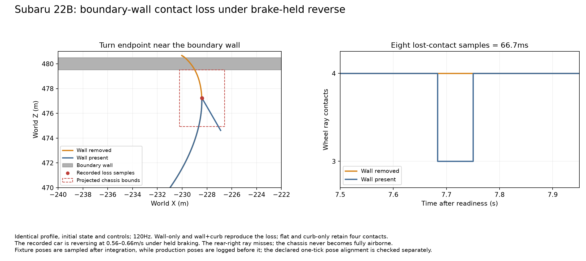
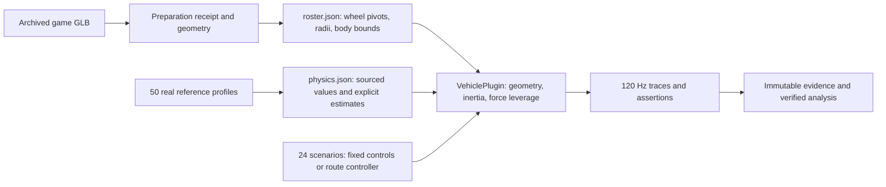

## Confirmed contact-loss episode: Subaru 22B

The 22B’s right trail-braking case loses the rear-right wheel ray for **eight ticks (66.7ms)** in both primary repeats. Four-ray contact is 99.04875% over the evaluated window; the car never becomes fully airborne. During those samples it is reversing at **0.562–0.658m/s**, with braking held and steering released, near the boundary wall.

A separate fixture copies the production vehicle code and exact profile, initial pose and scenario commands. Both diagnostic repeats are byte-identical. Flat floor and curb-only conditions retain four contacts; wall-only and wall-plus-curb reproduce the same eight lost-contact ticks. The wall is sufficient to cause this episode. This supports investigating the boundary/reverse interaction; it does not establish a general AWD tire-grip problem or validate real collision behavior.

Production pose logging occurs before Rapier integration, while this fixture samples after `app.update`. With that declared one-tick pose-epoch alignment, the combined-environment replay stays within **0.436mm** of the recorded trajectory; contact-loss tick indices already match without a shift. See `contact-investigation.json`, `contact-probe-method.json`, and the frozen source/executable under `artifacts/vehicle-reference/fleet-57/`.

## A further gearing approximation exposed by the fleet

`src/vehicle.rs` supplies the mean of **all four mesh radii** to engine force and RPM calculations, while visual wheel spin uses each wheel’s individual radius. For RWD cars with larger rear tires, this differs from using the driven axle’s radius: at fixed engine torque and gear ratio the model’s force/RPM factor is +4.70% for the Ford GT, +3.73% for the older NSX, and +2.76% for the Zonda. FWD and AWD require their own driven-axle/reduction interpretation.

This is a quantified model approximation, not a predicted sprint-time error: torque varies with RPM, traction can saturate, and the power ceiling changes the sensitivity. `driven-radius-review.json` preserves the calculation. A targeted driven-radius change and the same scenario/benchmark regression checks would be more informative than absorbing this gearing discrepancy into arbitrary power or tire adjustments. This evaluation leaves that production physics behavior unchanged.

## Data and physics map

The roster/profile join is the edition ID; the corpus join is `corpus_reference`; source-game models join through `source_code`. There are 37 RWD, 16 AWD and four FWD editions across six games. Gran Turismo 4 supplies 32/57 models, so source-game representation is broad but unequal.

Physics uses prepared wheel geometry rather than automatically replacing it with real wheelbase/track/tire dimensions. Published power, mass and gearbox values can therefore coexist with source-model geometry that differs from the real car. `CarSpec::wheelbase`, `PhysicsProfile::properties` and `PhysicsProfile::drive_force` show where those inputs enter steering, mass properties and drive force. Selected gearbox arrays contain complete overall reductions with `final_drive=1`; their field evidence explains this representation so reductions are not multiplied twice.

Ray contact and positive wheel load are separate metrics. The shared brake-to-reverse convention engages below 0.8m/s; reverse uses a shared force/taper rather than each real reverse gear. A held brake therefore does not promise a parked state. The model also retains estimated tire, steering, suspension, loss, shift and inertia behavior; forward gear data alone does not recover the original game’s complete drivetrain or the real car’s controls.

Only one fixed seed, one dry-road map and the declared fixture surfaces are covered. The results establish the observed contract, repeatability and qualified mismatches; they do not certify all 50 cars’ full real-world handling envelopes.
