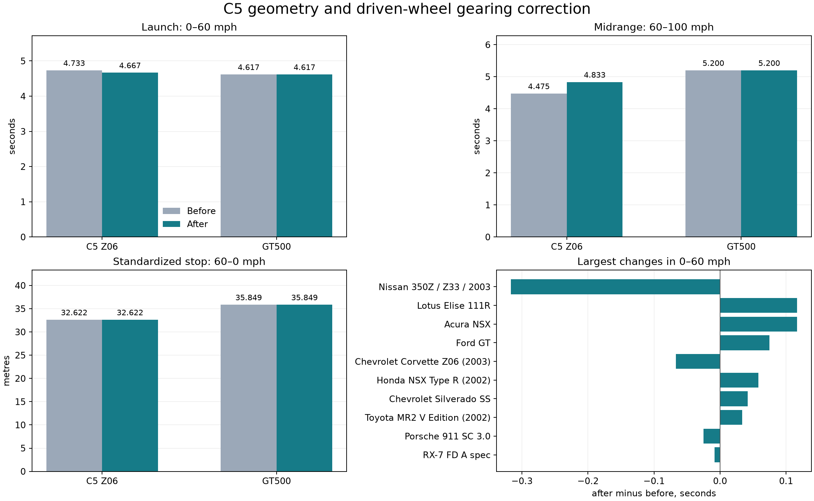

# C5 Z06 geometry and driven-wheel gearing correction

The C5 stock geometry and shared drivetrain radius bugs are fixed. All 2,736 matched executions passed, covering 57 editions × 24 scenarios × 2 repeats. All 1,368 repeat pairs have identical trajectories. Every scenario definition matches the frozen 57-car baseline. Timed controls match at every tick relative to each run's scenario-ready boundary; the C5's changed settling duration is retained with raw hashes and both readiness ticks in `input-comparison.json`. Closed-loop route tests use the same courses and controller definitions; their feedback commands can change with vehicle response. The GT500 retains its launch, midrange and handling improvements without profile retuning.

## What caused the errors

The C5's prepared meshes agree with their authored pivots; this was not a wheel reparenting error. The MC3 geometry has 2.8044 m wheelbase instead of 2.6543 m, 1.467 m tracks instead of 1.58496/1.59004 m, and 0.350495/0.368019 m tire radii instead of nominal 0.3219/0.33185 m. The correction moves and scales wheel assemblies and applies the reference body envelope to shell/collider bounds. Rendered and physical wheels share the new metadata. Source vertex, triangle and image bytes remain intact; affine transforms and the receipt explicitly record the correction. Source wheel-arch styling remains approximate.

Dimensions come from the existing `a08` corpus and `am_c5_specs` period specification reproduction, whose technical origin is less certain than the original manufacturer output sheet. Tire sizes yield unloaded nominal radii, not measured loaded rolling circumference. No tire coefficient, mass, engine output, gearbox ratio or suspension parameter was fitted to these results.

The drivetrain previously averaged all four tire radii even for RWD/FWD cars. Changing undriven tires could alter RPM and trigger a power-cutting shift. Production now averages driven-wheel RPM through a harmonic radius, weighted by the profile's nominal front-drive fraction. The same radius converts engine torque to force. AWD remains an explicit nominal-coupling approximation; existing load-sensitive force allocation remains separate. Suspension rest height still uses all four wheels for its different purpose.

## C5 Z06 result

| Measure | Before | After | Change |
|---|---:|---:|---:|
| 0–60 mph (s) | 4.733334 | 4.666667 | -0.066667 |
| 60–100 mph (s) | 4.475000 | 4.833334 | +0.358334 |
| 0–100 mph (s) | 9.208334 | 9.500001 | +0.291667 |
| 60–0 mph (m) | 32.622223 | 32.622482 | +0.000259 |
| 70–0 mph (m) | 44.238480 | 44.238632 | +0.000152 |
| 200 ft skidpad sustained g | 1.053210 | 1.050556 | -0.002654 |
| 200 ft skidpad peak tilt ° | 2.581492 | 2.175648 | -0.405843 |
| 300 ft skidpad sustained g | 1.054980 | 1.051551 | -0.003429 |
| 300 ft skidpad peak tilt ° | 2.668438 | 2.173218 | -0.495220 |

The smaller effective driven radius increases force at a fixed engine torque/gear, but also lowers road-speed shift thresholds. The calculated 3→4 threshold moves 106.258→98.152 mph, adding a shift before 100 mph. This is a kinematic explanation, not a recorded shift-event measurement; see `c5-gearing.json`. Wider tracks and corrected inertia reduce skidpad tilt while sustained lateral acceleration changes little. Standardized braking distance is effectively unchanged.

## GT500 preservation

| Measure | Before | After | Change |
|---|---:|---:|---:|
| 0–60 mph (s) | 4.616667 | 4.616667 | +0.000000 |
| 60–100 mph (s) | 5.200001 | 5.200001 | +0.000000 |
| 0–100 mph (s) | 9.816668 | 9.816668 | +0.000000 |
| 60–0 mph (m) | 35.849167 | 35.849167 | +0.000000 |
| 70–0 mph (m) | 48.584656 | 48.584656 | +0.000000 |
| 200 ft skidpad sustained g | 0.894613 | 0.894612 | -0.000001 |
| 200 ft skidpad peak tilt ° | 3.014803 | 3.014803 | +0.000000 |
| 300 ft skidpad sustained g | 0.896343 | 0.896345 | +0.000002 |
| 300 ft skidpad peak tilt ° | 3.080641 | 3.080514 | -0.000127 |

The longitudinal grip 1.24, lateral grip and .82 efficiency calibration remain byte-for-byte unchanged with every other physics profile. Launch and midrange timing remain identical at 120 Hz fixture resolution. Across the same 24 city cases, the largest absolute tilt change is 0.096295°. The detailed 150 s GT500 trace repeats exactly; its paired checkpoints, shifts and quarter-mile result are retained under the artifact directory. Skidpad differences below a few millionths of g are numerical-scale differences, not a handling retune.

## Fleet comparison

- `350z`: 0–60 mph 5.517 → 5.200 s.
- `ref-e13`: 0–60 mph 4.708 → 4.825 s.
- `gt4-nsx`: 0–60 mph 5.342 → 5.458 s.
- `ref-a07`: 0–60 mph 3.500 → 3.575 s.
- `ref-a08`: 0–60 mph 4.733 → 4.667 s.
- `ref-j06`: 0–60 mph 4.425 → 4.483 s.
- `ref-a12`: 0–60 mph 7.533 → 7.575 s.
- `ref-j15`: 0–60 mph 6.475 → 6.508 s.

These are measured effects of correcting radius coupling, not new per-car tuning. `reference-comparison.csv` retains the same 40 qualified real-reference comparisons across 24 of 57 editions, including related-variant and upper-bound qualifications; the remaining editions do not acquire new measured performance targets from this experiment. `all-57-cars.csv` gives every edition's paired acceleration, braking, skidpad, contact and tilt results; `comparison.json` includes all 1,368 car/case metric comparisons and the count of unchanged baseline trajectories per car. Null 100 mph endpoints remain censored at the unchanged 20 s horizon.

The rerun executed 7,638 assertions and 912 routes, with 114 requested resets and 0 unexpected resets. The largest route cross-track error was 3.790192 m inside the 7 m corridor. Minimum four-ray contact was 99.048751%; minimum four-loaded-wheel coverage was 98.335315%. Any remaining contact exception is itemized in `contact-comparison.json`; the baseline 22B wall-contact finding is retained rather than silently treated as a tuning target.

## Verification and evidence

- Full ladder: format, strict all-target Clippy, complexity, all-target/doc tests, Python controls, asset/source integrity, one recorded 57-car native acceptance run, fleet verification and provenance verification. Full log: `artifacts/vehicle-reference/fleet57-geometry-drivetrain/verification.log`.
- `compiled-source-diff.patch` compares captured production inputs against the accepted recorder-budget baseline; only the C5 roster row and two drivetrain source files differ. The earlier recorder-only baseline bridge is linked in `compiled-source-diff.json`.
- The production-path undriven-tire regression fails with the old averaging line and passes with the fix. AWD/RWD/FWD kinematic checks and geometry/forged-receipt controls pass. The C5 rebuild reproduces the GLB byte-exactly from its original archive; receipt JSON is semantically identical despite key ordering. Reapplying the correction is idempotent.
- Scenario run index: `artifacts/fleet57-geometry-drivetrain-20261025/runs.jsonl`; frozen binary and source provenance: `artifacts/vehicle-reference/fleet57-geometry-drivetrain/car-game.recorded.provenance`.
- Every finalized bundle is independently verified; six raw exports per execution are bound to immutable objects after declared policy redaction/numeric serialization. `validation.json` records final file hashes and audit counts. Runtime material and rebuild completeness do not imply full portable runtime replay.
- Older completed 40-car studies were losslessly archived with every file checked before unpacked copies were removed. Restore commands and full SHA receipts are in `artifacts/archives/`; the frozen 57-car baseline remains unpacked.

The experiment retains the same seed 17, 120 Hz timing, dry city and input definitions. It verifies this correction and regression coverage; it does not establish wet-surface, rough-road or full real-car fidelity.

