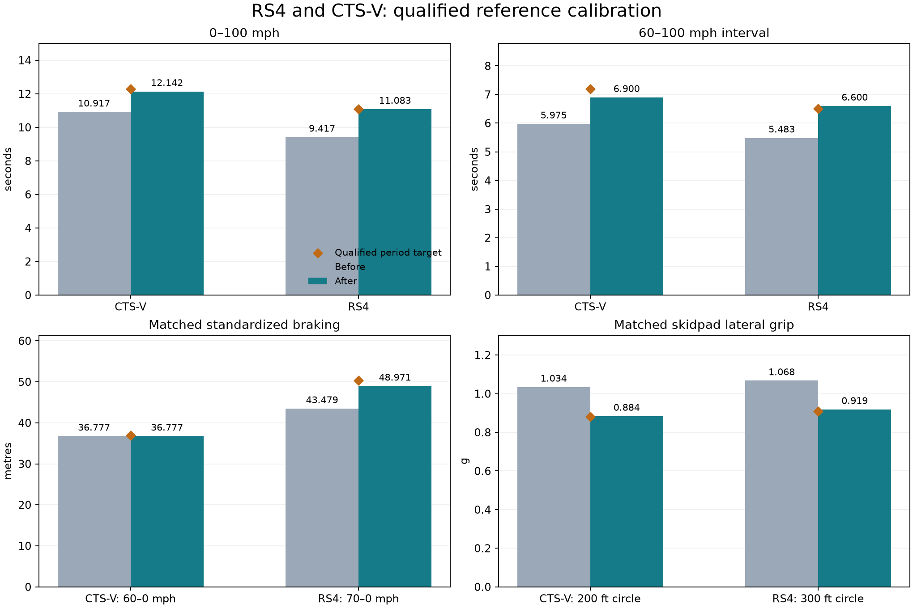

# Qualified RS4 and CTS-V reference calibration

The strongest supported remaining gaps were an incorrectly light US RS4 profile, estimated gearing, excessive RS4/CTS-V lateral grip, excessive RS4 service braking, and optimistic effective power delivery. Two profiles changed. All 57 geometries and the other 55 profiles are unchanged, including the GT500 and C5. All 2,736 matched executions passed; all 1,368 repeat pairs have identical trajectories. The 55 untouched editions retain all 2,640 baseline trajectories exactly.

## What the comparison supports

All 50 corpus reference cars are represented by 51 editions; six preserved legacy editions use separate sources without an exact corpus ID. [profile-coverage.csv](profile-coverage.csv) lists all 57 editions, their available corpus links, mass evidence, estimated/game-proxy parameters and standardized performance-comparison coverage. Blank corpus links remain explicit rather than forcing different variants together. The earlier 40 qualified performance comparisons cover 24 editions; missing measured targets do not become validation passes. Newly retrieved original road tests establish matched-diameter RS4 and CTS-V grip envelopes. Across eight selected reference observations, mean absolute percentage error fell 11.59%→1.38%. This is a calibration score on selected targets, not held-out proof of real-world fidelity.

The GNX 4.7 s result is a prototype test. The early NSX production/tire configuration and hot-weather correction remain unresolved, and no matched CSL tire/circle test was retrieved. The 911 asset market is inferred and its unladen simulation versus published performance-load basis is not established comparable. The Zonda's 1280 kg specification is dry mass, while 1370 kg is an explicit operating estimate; launch/test basis remains unknown. These discrepancies remain visible in [reference-evaluation.json](reference-evaluation.json), with reasons for deferral. A mass-only 911 sensitivity changes 0–100 km/h 5.617→5.950→6.400 s for illustrative added loads 0/75/170 kg. The 170 kg equals half the handbook's gross-minus-unladen difference, but neither payload CG nor equivalence to the separate 6.8 s dealer claim is established. This explains sensitivity; it is not a production calibration. See [911-load-sensitivity.json](911-load-sensitivity.json). Mini's less-than 11 s claim remains an upper bound rather than an 11 s equality target.

The largest remaining numerical differences in the original performance comparisons are listed below. The prototype, market, transmission and equipment qualifications matter: these are investigation priorities, not exact interchangeable targets. The Viper, Supra, Elise and 350Z need better matched test/configuration evidence before changing otherwise plausible engine delivery or launch traction.

| Remaining comparison | Simulated | Reference | Error | Reference qualification |
|---|---:|---:|---:|---|
| Buick GNX 0–60 mph | 6.025 s | 4.700 s | +28.19% | related prototype test |
| Porsche 911 SC 3.0 0–100 km/h | 5.617 s | 6.800 s | -17.40% | manufacturer hosted dealer claim exact year and engine |
| Buick GNX 70–0 mph | 49.393 m | 56.693 m | -12.88% | related prototype test |
| Viper GTS 0–60 mph | 4.400 s | 4.000 s | +10.00% | measured related year |
| Supra 0–60 mph | 5.058 s | 4.600 s | +9.96% | measured related year and market |
| Lotus Elise 111R 0–100 mph | 11.708 s | 13.000 s | -9.94% | manufacturer claim |
| Nissan 350Z / Z33 / 2003 0–100 mph | 12.550 s | 13.900 s | -9.71% | measured related equipment grade |
| Pagani Zonda C12S 7.3 (2002) 0–100 km/h | 4.050 s | 3.700 s | +9.46% | manufacturer claim |
| Ford Mustang GT 0–60 mph | 5.533 s | 5.100 s | +8.50% | related transmission test |
| Volkswagen Golf IV R32 0–60 mph | 5.925 s | 6.400 s | -7.42% | related reference |

## Audi RS4

Audi's 2007 US sedan technical sheet gives 1795 kg rather than the previously selected related European 1650 kg, 58% front weight, six forward ratios, 4.111 final drive and Cd 0.31 × 2.17 m² frontal area. These replace mismatched/estimated inputs. The 2007 sheet remains related-year evidence for the 2008 US edition. Conflicting engine unit/rpm labels do not override the later engine reference. Direct PDF access returned 403; indexed original tables supplied the values. Source qualifications and retrieval evidence are retained in the supplement.

Separate probes showed that OEM inputs alone change 0–100 mph 9.417→10.058 s. Corrected inputs plus estimated effective delivery 0.80 produce 11.083 s. Estimated `lateral_mu` 0.955 reduces excessive grip while leaving longitudinal tire grip separate. Estimated brake deceleration 9.75 m/s² corrects the overly short 70 mph stop. These model parameters are not measurements of drivetrain loss, tire friction or brake hardware.

| Measure | Before | After | Qualified reference |
|---|---:|---:|---:|
| 300 ft skidpad (g) | 1.068 | 0.919 | 0.910 |
| 0–60 mph (s) | 3.933 | 4.483 | 4.600 |
| 0–100 mph (s) | 9.417 | 11.083 | 11.100 |
| 70–0 mph (m) | 43.479 | 48.971 | 50.292 |

The C/D 2007 US sedan test used PZeroRosso road tires, 3980 lb published test-car weight and weather correction for 97°F/2000 ft conditions. Its separate race-track session used different tires and is not the source of the 0.91 g target. [Audi original technical sheet](https://www.audiworld.com/model/rs4/07/07AudiRS4_TechSpecs.pdf), [C/D original test](https://www.caranddriver.com/reviews/a18200959/2007-audi-rs-4-quattro-road-test-review/).

## Cadillac CTS-V

The existing nominal LS6 output, 1746 kg mass, gears and longitudinal tire coefficient are unchanged. The default 0.88 delivery assumption made 60–100 mph too quick: 5.975 s versus MotorTrend's 7.2 s interval. Independent delivery probes selected an effective 0.77 model estimate, giving 6.900 s. Lowering `lateral_mu` to 0.92 corrects the 0.88 g 200 ft observation without altering standardized braking or straight-line traction limits. Lateral-only probes leave acceleration and braking unchanged, so engine delivery is not hidden inside a tire-grip correction.

| Measure | Before | After | Qualified reference |
|---|---:|---:|---:|
| 200 ft skidpad (g) | 1.034 | 0.884 | 0.880 |
| 0–60 mph (s) | 4.942 | 5.242 | 5.100 |
| 0–100 mph (s) | 10.917 | 12.142 | 12.300 |
| 60–0 mph (m) | 36.777 | 36.777 | 36.881 |

MotorTrend supplies the 2004 LS6 acceleration/braking observations; Autoweek supplies the matched 200 ft skidpad. Autoweek's separate 5.35 s launch and 112 ft braking differ from MotorTrend's 5.1 s/121 ft, illustrating test-condition spread. The new 5.242 s launch sits between those observations. Unknown rollout is not converted. [MotorTrend original comparison](https://www.motortrend.com/reviews/comparison-2004-cadillac-cts-v-vs-jaguar-s-type-r-archive), [Autoweek original test](https://www.autoweek.com/news/a2086961/2004-cadillac-cts-v-flying-v-cadillacs-cts-v-simply-shreds/).

## Preservation and same-scenario evaluation

GT500 0–60 mph remains 4.616667 s and 60–100 mph remains 5.200001 s. Its 150 s trace and both skidpads match the accepted baseline exactly. Its longitudinal 1.25/lateral 0.935 grip estimates and 0.82 delivery calibration are unchanged. The C5 retains its corrected 2.6543 m wheelbase, tracks, tire radii and body envelope, with 0–60 mph 4.666667 s and both skidpads exactly unchanged. 

All 57-car fixture results repeat exactly. The 55 unchanged acceleration/braking rows and 110 unchanged circle rows match the baseline exactly. The same seed 17, 120 Hz timing, 24 scenario definitions and route/course hashes are retained. Timed controls compare at each recorded scenario-ready epoch; raw hashes/readiness shifts are retained. Closed-loop route feedback may adapt to changed vehicle response, with controller definitions unchanged.

The matrix passed 7,638 assertions and all 912 routes. There were 114 requested resets and 0 unexpected resets. Maximum cross-track error was 3.790192 m within the 7 m corridor. Minimum four-ray contact was 99.048751%; minimum four-loaded-wheel coverage was 98.335315%. [contact-comparison.json](contact-comparison.json) retains every exception and its baseline, including the earlier 22B wall-contact investigation.

## Verification and inspectable evidence

- Both new production regression guards fail on the old profiles and pass after correction. Tests reuse the production skidpad fixture and compare launch, 100 mph, midrange and standardized braking envelopes.
- Isolated probes separate OEM inputs, delivery, grip and braking; shadow baseline fixtures match production exactly. Sources, binaries, parameter files and all attempts are retained under `artifacts/vehicle-reference/fleet57-reference-calibration/` and summarized in [parameter-experiments.json](parameter-experiments.json).
- Comparing the two recorded source snapshots finds only `assets/cars/physics.json` changed among compiled application inputs; runtime physics code is preserved. See [compiled-source-diff.json](compiled-source-diff.json).
- Full ladder: format, strict Clippy, complexity, all-target/doc tests, Python/asset controls, one recorded 57-car native acceptance run and provenance verification. Log: `artifacts/vehicle-reference/fleet57-reference-calibration/verification.log`.
- Frozen recorded executable and source provenance: `artifacts/vehicle-reference/fleet57-reference-calibration/car-game.recorded.provenance`. Full study index: `artifacts/fleet57-reference-calibration-20261025/runs.jsonl`.
- All 2,736 evidence bundles independently verify runtime material/rebuild completeness. Six raw exports per execution are bound to immutable objects after declared redaction/numeric serialization; full portable runtime replay is not claimed. [validation.json](validation.json) records the final hashes.
- [all-57-cars.csv](all-57-cars.csv) contains every paired result; [comparison.json](comparison.json) contains all 1,368 car/case comparisons. [primary-comparison.csv](primary-comparison.csv) and [reference-comparison.csv](reference-comparison.csv) retain reference qualifications. Sources: [handling-source-notes.md](handling-source-notes.md) and `docs/vehicle-reference/calibration-supplement-20261025.json`.
- The older initial 57-car study was losslessly archived, with every file read back and verified before removing its unpacked directory. Restore instructions are in its `artifacts/archives/` receipt. The current comparison baseline remains unpacked.

Remaining high-leverage evidence: matched production GNX/early NSX tests, a same-market 911 test at known load, a Zonda operating mass/launch basis, and a CSL test on identified tires/circle. These would justify further calibration; arbitrary changes to nominal outputs would not resolve those reference gaps. Wet tires, rough surfaces and full suspension/differential fidelity remain outside this dry-city experiment.

