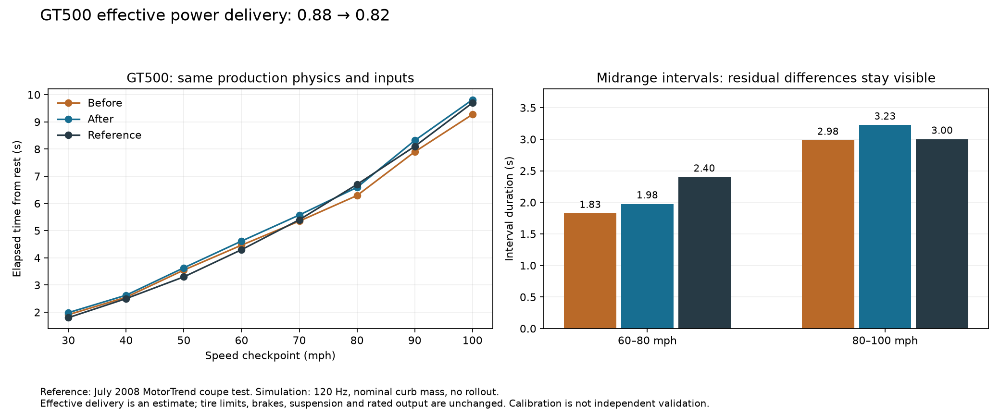
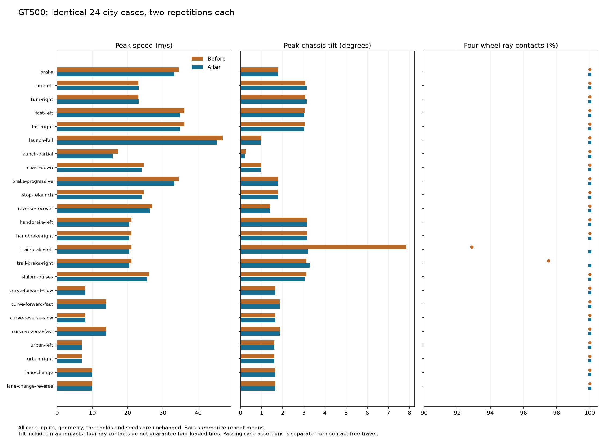

# GT500 midrange power-delivery correction

The previous launch-grip calibration exposed a pre-existing engine-limited acceleration mismatch. The original GT500 needed 5.150 s to reach 60 mph and 9.967 s to reach 100 mph: a 4.817 s interval. The last calibration improved launch to 4.467 s but left essentially the same 4.808 s midrange. The July 2008 MotorTrend coupe test reports 4.3 and 9.7 s, implying a 5.4 s interval. A new production-physics regression fails on that 4.808 s result.

The targeted fix changes only the GT500's **estimated effective accelerating power-delivery factor from 0.88 to 0.82**. It leaves the force model, rated engine output, torque shape, mass, gearing, shift duration, electronic governor, longitudinal/lateral tire limits, brakes, suspension, models and city/scenario geometry unchanged. The factor remains an estimate that aggregates unresolved losses and rotational dynamics, not a recovered mechanical efficiency or wheel-dyno measurement.

[Validation receipt](validation.json) · [scenario summary](completion-summary.json) · [matched scenario deltas](scenario-deltas.json) · [Numerical comparison](comparison.json) · [all 40 fixture measurements](all-40-fixtures.csv) · [one parameter change](parameter-changes.json) · [scenario protocol equality](protocol-equality.json).

The production result is **5.200 s from 60–100 mph**, versus 4.808 s before and a qualified 5.4 s period-test interval. Launch remains improved at **4.617 s to 60 mph**, versus the original 5.150 s; it gives back 0.150 s from the last tune. Steady-circle grip and standardized braking are preserved. All **1,920** unchanged scenario reruns completed successfully.

## Why the midrange was too fast

From 60–100 mph the production trace applies 100% of requested longitudinal tire force in second and third gear. The tires are not clipping engine delivery. Reverting longitudinal grip from 1.25 to the original 1.08 restores the weak launch but barely changes the interval, from 4.808 to 4.817 s. Consequently, undoing the grip improvement cannot repair midrange power delivery.

At fixed RPM and gear, the correction reduces requested wheel force by 6.8%. The early launch is partly traction-limited, which is why its time changes less than the engine-limited midrange.

Four ranked hypotheses were checked. Changing one estimated factor at a time gives these diagnostic results:

| Intervention | 0–60 mph | 60–100 mph | Interpretation |
|---|---:|---:|---|
| Last accepted calibration | 4.467 s | 4.808 s | Engine-limited midrange is too quick. |
| Original longitudinal grip, 1.08 | 5.150 s | 4.817 s | Loses the launch improvement without fixing midrange. |
| Estimated effective delivery 0.82, selected | 4.617 s | 5.200 s | Keeps most launch improvement; corrects delivered power across gears. |
| Estimated effective delivery 0.80 | 4.692 s | 5.342 s | Closer interval but sacrifices more launch performance. |
| Shift interruption 0.30 → 0.60 s | 4.792 s | 5.167 s | Inserts delay into both launch and midrange; does not correct force between shifts. |
| Add 80 kg to curb mass | 4.542 s | 5.025 s | Explains only part of the difference and changes the selected mass basis. |
| Rotational sensitivity: 0.5 kg·m² engine, 60 kg equivalent wheels | 4.725 s | 5.300 s | Missing rotational work is plausible, but this force-scale sensitivity is not a complete energy-conserving drivetrain or recovered inertia. Not shipped. |

The engine's published peak torque/power and gearing agree with [Ford's 2008 supplement, p.38](https://www.mustangspecs.com/wp-content/uploads/2020/05/2008-Ford-Shelby-GT500-Supplement.pdf). Those data constrain the existing estimated torque curve but do not determine its complete shape. Timing data alone cannot distinguish exact losses, rotating inertia, boost delivery and torque-curve errors. The supported runtime diagnosis is excessive effective wheel power in the engine-limited band; the simplest existing parameter corrects that without inventing a new speed-dependent power cut or an OEM torque curve.



## Measured tradeoffs and guardrails

The selected production implementation reproduces the diagnostic trial's full sampled trajectory exactly. The regression requires 0–60 mph within 4.0–4.7 s and the 60–100 interval within 5.1–5.8 s. These are broad calibration guards, not confidence intervals.

The new launch is **0.150 s slower** than the last tune but remains **0.533 s faster** than the original 5.150 s. Thus it preserves most of the launch improvement, not the exact previous time. The interval's shortfall falls from 0.592 to 0.200 s, and total 0–100 changes from 9.275 to 9.817 s versus the period 9.7 s.

A separate quarter-mile observation was retained to check the direction of the change: the crossing speed falls from 116.961 to 114.340 mph versus the period test's 114.2 mph. Elapsed time changes from 12.550 to 12.783 s versus 12.6 s, so that timing becomes less accurate. The probe uses no rollout and an instantaneous crossing speed; the publication's rollout, load and timing-trap method are not fully specified. This is useful corroboration of excessive effective power, not an exact road-test replication.

The subinterval shape is still imperfect: 60–80 mph changes from 1.825 to 1.975 s versus 2.4 s, while 80–100 changes from 2.983 to 3.225 s versus 3.0 s. The modeled second-to-third shift occurs around 81 mph; the publication does not give its shift trace. The scalar correction improves the whole interval without claiming to recover gear-specific losses or the driver’s exact shift strategy.

The tire coefficients, brake force, steering and suspension are identical to the last accepted calibration. Quasi-steady 200-/300-ft-circle sweeps, standardized braking and the full original city cases are rerun to check actual behavior, because unchanged handling parameters do not guarantee unchanged paths when speed changes.

## Trail-brake map interactions

Both GT500 trail-brake directions now retain 100% four-wheel-ray contact in both repeats, compared with 92.866% left and 97.503% right before. The left peak tilt falls from 7.842° to 3.203°. The right peak rises slightly from 3.118° to 3.270°; the change is not uniformly better in every metric.

A controlled remeasurement runs the same authored controls through the frozen production `VehiclePlugin`. Flat ground peaks at 3.113° in either direction. Adding only the exact nearby sidewalk block and perimeter wall raises peaks to 3.204° and 3.270°, agreeing with the recorded city maxima within 0.001°. Four ray contacts therefore do not imply collision-free travel: small map interactions remain. No scene geometry, controls or assertion thresholds were changed. These simulator counterfactuals do not validate real curb-impact dynamics.

[Surface comparison and source hashes](trail-surface-proof.json) · [counterfactual helper](trail-surface-benchmark.rs). The full frozen helper source/executable and raw samples are retained under `artifacts/vehicle-reference/gt500-midrange`.

## Evidence and reproduction

The before cohort is `artifacts/fleet40-calibrated-v2-20261024`; its original accepted executable is retained independently in `artifacts/vehicle-reference/gt500-midrange/before-car-game.recorded`. The previous [calibration report](../fleet-40-calibration/README.md) and its frozen profiles/measurements describe that baseline.

The diagnostic helper source and executable are retained in `artifacts/vehicle-reference/gt500-midrange/diagnostic-source` and `diagnostic-probe`, with a SHA-256 receipt. The helper is deliberately isolated under `.scratch/gt500-midrange-probe`, with a distinct Cargo package identity. Only that helper accepts labelled parameter interventions. The production `examples/gt500_trace.rs` has no overrides; the actual runtime still consumes its compiler-bound profile. Diagnostic files beginning `invalid-quarter-origin-` retain an early erroneous absolute-Z quarter-mile measurement; those quarter results are excluded. Corrected probes measure distance from the settled start pose. The original-grip corrected probe uses 1.08, not the exploratory 1.12.

```sh
cargo test --test vehicle_profiles gt500_midrange_does_not_hide_behind_a_slow_launch -- --nocapture
cargo run --example gt500_trace
cargo run --example fleet_benchmark
cargo run --example fleet_skidpad
CAR_GAME_MUTE=1 bash scripts/verify.sh --recorded --base HEAD
python3 tools/run_fleet40_study.py --output artifacts/fleet40-gt500-midrange-new \
  --binary target/release/car-game.recorded --repeats 2 --workers 4 \
  --recorder-queue-bytes 33554432 --recorder-queue-records 32768
python3 tools/audit_fleet40_evidence.py artifacts/fleet40-gt500-midrange-new \
  --output artifacts/fleet40-gt500-midrange-new/evidence-audit.jsonl
python3 tools/analyze_fleet40_study.py artifacts/fleet40-gt500-midrange-new \
  --output artifacts/fleet40-gt500-midrange-new/analysis
```

The final runner uses the identical 40-car × 24-case × two-repeat protocol and observer queue limits. Its new cohort is `artifacts/fleet40-gt500-midrange-20261024`. The cache was seeded with hard links to immutable content-addressed evidence objects to conserve disk space; every scenario process still executed afresh and its evidence was independently audited. No historical measurements were substituted.

Primary sources: [MotorTrend's original July 2008 instrumented comparison, republished June 2026](https://www.motortrend.com/reviews/2008-dodge-challenger-srt8-vs-ford-shelby-gt500-comparison-test-archive); [Ford 2008 owner supplement](https://www.mustangspecs.com/wp-content/uploads/2020/05/2008-Ford-Shelby-GT500-Supplement.pdf). Both were reviewed on 2026-10-24. The Jev browser read the complete comparison; its PDF navigation started a download, so the Ford PDF was inspected through the web PDF reader.

The complete verification ladder has passed: 82 Rust tests, strict Clippy and complexity gates, assets/tooling checks, and the recorded native fleet check with 40 successful scripts and 160 captures. All five overview pages and the GT500 driving image were inspected. The accepted binary is `343cbd08aaa9a8ca4e5a1a0cfa7e67ba53e7550d6632c425bb6b2de09b47a0a4`; the native run is `artifacts/runs/20261024T234234940692Z-2342545-fleet-29313-1-1792885354970544000`.

## Final recorded results

- All **1,920** new processes exit successfully with healthy recording. All **5,360 assertions** execute and pass; all **640 routes** complete within the unchanged 7 m corridor. Maximum cross-track error is **3.790 m**.
- There are **no unexpected resets**. The **80 requested resets** are part of the original braking protocol.
- All runs retain **100% four-wheel-ray contact in the post-launch analysis windows**. The minimum four-loaded-wheel fraction is **98.335%**; a ray contact does not require positive tire load.
- All **960 car/case repeat pairs** have identical sampled trajectory hashes on this build/platform. All **1,872 matched trajectories for the other 39 cars** are also identical to the previous build.
- All **1,920 evidence bundles** pass source/build/runtime-material audits. Build-input comparison with the previous accepted native run finds only `assets/cars/physics.json` changed; its sole physical parameter change is the GT500 delivery factor. Complete cross-platform replay is not claimed.

Contact and trajectory summaries use the unchanged post-launch window (relative tick ≥240; the deliberate brake-reset tail is excluded). Passing original case assertions does not establish real-car fidelity or collision-free travel.



[All run and aggregate metrics](results.json) · [aggregate CSV](results.csv) · [evidence audit](evidence-audit.jsonl) · [verification log](../../../artifacts/vehicle-reference/gt500-midrange/verification.log). Deterministic numeric precision does not imply equal precision in real-world reference measurements.

