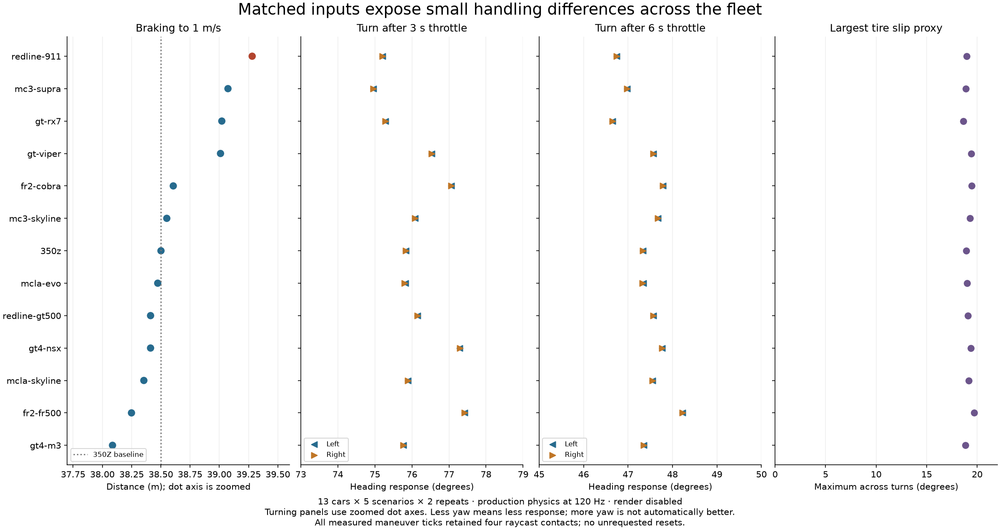
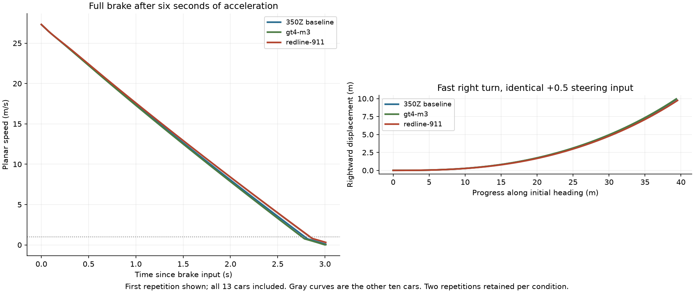

# Matched fleet handling: Redline 911 is the first car to investigate

Measured on October 23, 2026, using source commit `2342545363c225929963d16b5a05ca26e0ca2798` and binary SHA-256 `cc39892dee1beca073caf9cdb91e3f52674e640a9e53e377be1e97b6e59f30fc`.

**The Redline 911 is the clearest first target for a handling investigation.** It needed **39.28 m / 2.85 s** to brake to 1 m/s, the longest distance and time in the fleet. That is **1.19 m (3.13%) farther** than the GT4 M3's 38.09 m, and 2.02% farther than the baseline 350Z. The 911 also had the largest chassis tilt (5.21°) and the second-smallest heading response at both approach speeds. Its tilt remained small; this is not evidence of rollover or a safety failure.

The least steering response depends on the maneuver: **MC3 Supra** turned only **74.96°** in the two-second lower-speed turn, while **GT RX-7** turned only **46.65°** in the 1.5-second faster turn. The FR500 responded most strongly but also recorded the largest tire-slip proxy (**19.70°**), so more yaw should not be treated as an unconditional win.

**Ground support and resets were ties:** all **30,574 measured maneuver ticks** had four raycast contacts and four wheels with loads above 1 N. There were no airborne measurement ticks and **zero unrequested resets across all 130 runs**. All 26 deliberate recovery resets produced correlated upright/stopped transitions; after one second, maximum planar speed was 0.0000021 m/s and planar displacement was zero.

These conclusions describe the current simulation with shared arcade tuning on a smooth road. They are not rankings of the real cars, and they do not establish performance over curbs, off-road or during handbrake slides.



## Complete fleet comparison

Values are means of two repetitions. L/R means left/right turns. Braking ends at **1 m/s (3.6 km/h)**; continuing to hold the brake eventually selects reverse, which is deliberately excluded from the braking distance. Four-contact percentage uses maneuver ticks only; reset totals cover the entire run. Cars are ordered by braking distance, with rounded ties retained.

| Car | Brake distance m | Brake time s | Low turn ° L/R | Fast turn ° L/R | Max turn slip ° | Max turn tilt ° | Four contacts | Unrequested resets |
|---|---:|---:|---:|---:|---:|---:|---:|---:|
| `redline-911` | 39.28 | 2.850 | 75.21/75.21 | 46.74/46.74 | 18.94 | 5.21 | 100% | 0 |
| `mc3-supra` | 39.07 | 2.833 | 74.96/74.96 | 46.98/46.98 | 18.89 | 4.97 | 100% | 0 |
| `gt-rx7` | 39.02 | 2.825 | 75.29/75.29 | 46.65/46.65 | 18.62 | 4.48 | 100% | 0 |
| `gt-viper` | 39.01 | 2.825 | 76.53/76.53 | 47.57/47.57 | 19.41 | 4.53 | 100% | 0 |
| `fr2-cobra` | 38.61 | 2.800 | 77.07/77.07 | 47.79/47.78 | 19.47 | 4.31 | 100% | 0 |
| `mc3-skyline` | 38.55 | 2.792 | 76.08/76.08 | 47.67/47.67 | 19.28 | 4.66 | 100% | 0 |
| `350z` | 38.50 | 2.792 | 75.83/75.83 | 47.33/47.33 | 18.93 | 4.40 | 100% | 0 |
| `mcla-evo` | 38.47 | 2.792 | 75.82/75.80 | 47.34/47.33 | 18.98 | 4.58 | 100% | 0 |
| `redline-gt500` | 38.41 | 2.783 | 76.15/76.15 | 47.57/47.57 | 19.07 | 4.21 | 100% | 0 |
| `gt4-nsx` | 38.41 | 2.783 | 77.29/77.29 | 47.77/47.77 | 19.39 | 4.16 | 100% | 0 |
| `mcla-skyline` | 38.35 | 2.783 | 75.89/75.89 | 47.55/47.55 | 19.15 | 4.82 | 100% | 0 |
| `fr2-fr500` | 38.25 | 2.775 | 77.42/77.42 | 48.23/48.23 | 19.70 | 4.31 | 100% | 0 |
| `gt4-m3` | 38.09 | 2.758 | 75.76/75.77 | 47.36/47.36 | 18.83 | 4.45 | 100% | 0 |

All runs passed their car-identity and reset-count assertions. None was excluded from the comparison. The largest low-speed left/right difference was about 0.0224° (MCLA Evo); left/right findings agree on the extrema.



## What was held constant

The matrix is **13 cars × 5 scenarios × 2 repetitions = 130 runs**. Each run invokes the existing production CLI with `--render-disabled`; city colliders, command dispatch, physics, assembly projection, recorder and prepared asset loading remain production systems. No game physics, tuning, roster or runtime source was changed.

Each car starts at `[-150, 0.62, 458]`, heading +X along the obstacle-free perimeter road, with sandbox access and seed 17. The fixed step is 120 Hz. Scenario readiness differs slightly with startup cadence; **every input timeline is relative to readiness and includes two seconds of settling**. Recorded effective inputs were checked at every tick and have exactly one canonical hash per case across all cars and repetitions. The 350Z's intact assembly pilot projects the calibrated baseline mass/inertia; other cars use baseline mass properties directly.

| Scenario | Identical input schedule after readiness | Measurement window |
|---|---|---|
| Brake | Settle 2 s; full throttle 6 s; full brake 4 s; release; request reset at 14 s | From brake consumption to first completed speed ≤1 m/s; reset recovery at +1 s |
| Turn left/right | Settle 2 s; full throttle 3 s; steer −/+0.5 with full throttle for 2 s | Full two-second steering window |
| Fast left/right | Settle 2 s; full throttle 6 s; steer −/+0.5 with full throttle for 1.5 s | Full 1.5-second steering window |

The approach speeds were approximately **58.38 km/h** for the lower-speed turns and **98.32 km/h** for braking/faster turns. Identical throttle histories produce slightly different speeds by geometry: braking entry ranged from 27.2994 to 27.3215 m/s (less than 0.09%). This is an identical-input comparison, not a manually normalized-speed comparison.

The entire measured chassis footprint, including both rotated collider cuboids, stayed between the sidewalk boundary at z=436 and the wall at z=479.5, with **at least 2.483 m clearance**. All measured x positions stayed safely inside the perimeter strip. A preliminary 350Z course-design pilot had hit the wall after steering ended and coasting began; that pilot is separate in `artifacts/handling-pilot/`. The final protocol was fixed before the 130-run batch and omits that coasting phase. No final result was filtered because of handling quality.

## Metric boundaries and uncertainty

- **Braking distance/time:** completed positions and planar velocities from `simulation.completed`, beginning at the completed state immediately before the full-brake command. Cumulative planar distance ends on the first ≤1 m/s tick. The game switches brake to reverse near a stop; a later reverse speed is not a braking failure. Sampling resolution is one 120 Hz tick (8.33 ms).
- **Turning response:** direction-normalized, unwrapped heading change from quaternion orientation over the exact steering interval. Less heading change means less response under this protocol. Without a target path or driver correction task, it does not prove that the most responsive car is easiest to control.
- **Support/slip/tilt:** raycast contact count and loads are sampled before the solver, during the maneuver. Chassis tilt includes pitch and roll; the tire-slip field is the runtime's maximum per-wheel angle/speed proxy. These are distinct from completed-state pose/velocity.
- **Reset success:** `vehicle.reset` events, correlated command IDs, before/after transitions and completed-state recovery. The successful reset event does not require an additional `command.outcome`. No selection events inflate reset counts.
- **Repeatability:** 53 of 65 car/case pairs had byte-identical selected numeric trajectories. The other pairs varied slightly; the largest turn-angle spread was **0.000264°**, and all braking distances/times matched across repeats. These two repetitions establish local repeatability, not statistical confidence intervals or cross-platform determinism.

## Evidence and reproduction

- [Executed analysis notebook](analysis.ipynb): independent recomputation from raw traces plus saved plots and all-car table.
- [Comparison CSV](comparison.csv): all 65 car/case aggregates, including observed ranges across repetitions.
- [Per-run CSV](per-run.csv): 130 runs with actual metrics, paths and input/trajectory hashes.
- [Evidence index](evidence.json): every run directory, its key file hashes, assets and metrics.
- [Frozen protocol and assignments](protocol.json): all scenarios and 130 preregistered assignments.
- [Validation summary](validation.json) and [130 provenance verification results](provenance-verification.json).
- Raw run directories, scenario JSONs, logs, commands, inputs, physics, completed-state events and content-addressed provenance objects are under [`artifacts/handling-study-20261023`](../../../artifacts/handling-study-20261023). They are local ignored artifacts, not committed binary data. Use the exact per-run path in the evidence index rather than `artifacts/latest`.

```sh
cargo build --locked
python3 tools/run_handling_study.py --output artifacts/handling-study-new --workers 4
python3 tools/analyze_handling_study.py artifacts/handling-study-new
# Inspect a selected run without requiring GPU/gameplay capture acceptance:
python3 tools/verify_run.py --health-only PATH_TO_RUN
python3 tools/evidence_manifest.py --action verify --run PATH_TO_RUN
```

The notebook reads the frozen evidence in this directory and exact raw run paths. Its plotting/notebook dependencies are pinned in [python-requirements.txt](python-requirements.txt); the runner/analyzer use Python's standard library. To rerun the notebook after installing those dependencies, execute it with nbclient from the repository root.

Verification completed: formatting, strict all-target Clippy, complexity limits, **67 Rust tests**, seven analysis-boundary tests, Python syntax checks, all-run input/tick/health/course audits, independent notebook recomputation of braking/yaw/support/reset totals, **130 complete provenance-object verifications**, and visual inspection of both saved figures. The ordinary build captures exact binary/content identity but does not claim compiler-bound rebuild identity or cross-platform replay guarantees.

The source-preservation asset checker was also attempted. Its baseline local receipt check passed, but checking the other 12 originals failed because the sibling `carmodels` archive is absent; the failure is retained under `artifacts/asset-check-failure-20261023T223710Z.json`. This does not prevent using the bundled prepared fleet: all 130 runs share the same captured asset hashes. No GPU/window visual acceptance is claimed.

The next handling work should start with the 911 braking response, preserve the Supra and RX-7 as low/high-speed steering-response regression cases, and compare the FR500's stronger response with its higher slip before changing grip or yaw assistance.
