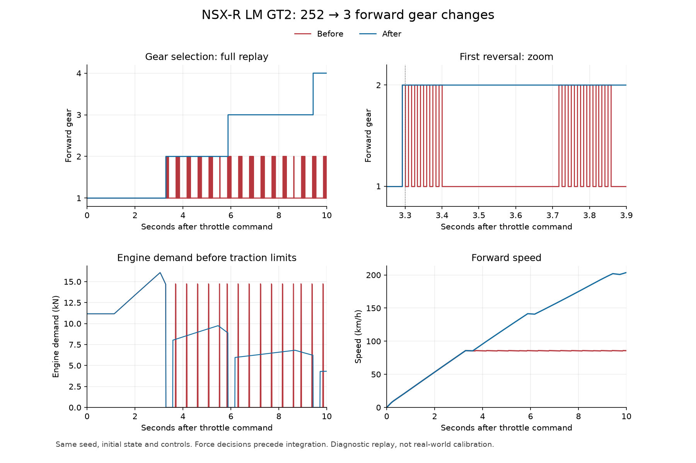

# NSX-R LM GT2 transmission hysteresis

The new decision trace localizes the historical failure to overlapping automatic
shift rules. With estimated ratios 3.3 and 2.0, the 8,740 rpm upshift threshold
lands at about 5,297 rpm, below the nominal 5,330 rpm downshift threshold. The
production trace changes gears again on the next tick and repeatedly restarts
the 0.3 second torque interruption. All four contacts remain accepted.

`PhysicsProfile::downshift_rpm` caps the nominal downshift threshold so the target
lower gear stays at least 5% below its own upshift threshold. This controller
hysteresis is an explicit approximation, not a claim about the original race
car's gearbox software. Nominal and effective thresholds are both exposed in the
JSON decisions. Engine output, ratios, shift duration, tires, suspension, geometry
and roster are unchanged. The cap affects eleven fleet profiles; the protected
GT500, C5, RS4 and CTS-V retain their original thresholds.

The original production regression failed with 592 gear changes. Minimizing to
the existing obstacle-free 20-second launch case 49 still failed with 595 changes.
The regression now requires at most ten changes, engagement of third gear, and
engine demand on at least 85% of the final ten seconds. A separate coast-down
control checks engagement and legitimate downshifts.

The original 20-second city reproduction is retained unchanged. The first fixed
candidate reaches approximately 75.9 m/s, then collides with the road boundary at
x≈477 m and fails its final speed assertion. Its five raw gear changes (three forward-gear transitions) are not the old
hunting symptom. This is a finite-course limitation; the common fleet matrix and
historical city scenario are not edited to turn that failure into a pass.

Evidence lives under `artifacts/nsx-gear-hunting-fix/`. `compare.py` checks all
5,024 cases per car against the accepted baseline, including the prior common
slope revision and exp-161 profile repair. It compares both repeated trajectory
hashes, metrics and normalized scenario outcomes, and requires exact equality for
the four protected cars. Final matrix, native verification and diagnosis results
must be taken from their receipts, not inferred from this methodology.

The matched ten-second production replay has 409 identical legacy physics samples.
At tick 410 the first differing fields are only gear and RPM: the old controller
returns to first, while the fixed controller holds second. Recorded effective
downshift thresholds are 5,330 versus 5,032.121 rpm, with all four contacts accepted.
The replay reduces forward gear transitions from 252 to 3 and the zero-demand
fraction during the final five seconds from 94.3% to 11.7%; both runs pass their unchanged replay assertions. These values
come from `ten-second-comparison.json` and `first-shift-decision-difference.json`.

The matrix retains compact repeat hashes and failure traces. Full shift/contact
decisions are verified in the recorded replays and native run; the matrix does
not retain full decision streams for every passing execution. The comparison also
requires exact trajectories for all 289 profiles whose thresholds are unchanged.

A separate controlled gear-reversal stream exercises the automatic hunting window
without retaining the production bug as a test expectation. All six incident
window controls pass. The corrected nominal/effective shift thresholds also survive
verified portable export. Supplemental gates cover this added test; production
sources and the running recorded executable remain unchanged.

The completed numerical rerun covers 3,014,400 executions with zero divergent
repeat pairs. All 289 profiles whose thresholds are unchanged match their
baseline trajectories, metrics and scenario outcomes exactly. Changes are confined
to the eleven audited profiles. No failed case was added or removed: the previous
39 rollover cases and one city failure remain. The NSX changes 1,429 proving-ground
cases and ten city cases; its common 20-second full-throttle launch now reaches
287.5 km/h versus 85.7 km/h, with four-wheel contact throughout both runs. This
establishes removal of the transmission stall, not real-world performance accuracy.

During verification, three bounded shutdown controls missed their existing startup
deadline under twelve-worker matrix load, before advancing beyond physics tick
zero. Their retained health reported an unclean/unknown exit, not a vehicle
failure. Isolating those controls allowed them to pass with unchanged deadlines;
the original matrix workers then resumed. All-target tests passed again after
the matrix completed, while native verification continued. The failed attempts
remain under `verification-attempt1/` and `artifacts/logs/grid-shutdown-52526-*`.
No host scheduling cause is claimed from the available telemetry alone.

Final verification passed: all 300 native drive scripts, wheel animations and
1,200 captured views were accepted from the same recorded build. Recorder closure
was healthy, with no losses, pending automatic export or triggered incident
windows. Runtime material and rebuild-source provenance were verified. Native
asset hashes also match the pre-fix 300-car cohort, and profile/roster bytes are
unchanged. The final binary SHA-256 is
`f19f84e539b1ac1b1e4ba57fb87f724cdb8478fc066062f43be98f44c8f4d525`.

[Machine-readable validation](validation.json) binds the full matrix, comparison,
matched replays, source preservation, native evidence, gate logs and figure inputs.
The instrumentation-only preservation receipt remains separate in
[diagnosis/validation.json](../diagnosis/validation.json).

The unchanged failures are Hummer H2 (`ref-a13`): 35 rollover cases; Daihatsu Midget II D-type '98 (`exp-070`): 4 rollover cases; Fiat 500F '65 (`exp-018`): 1 city case.
