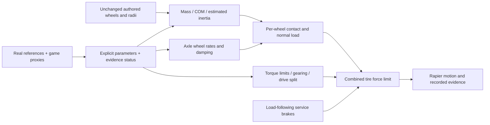
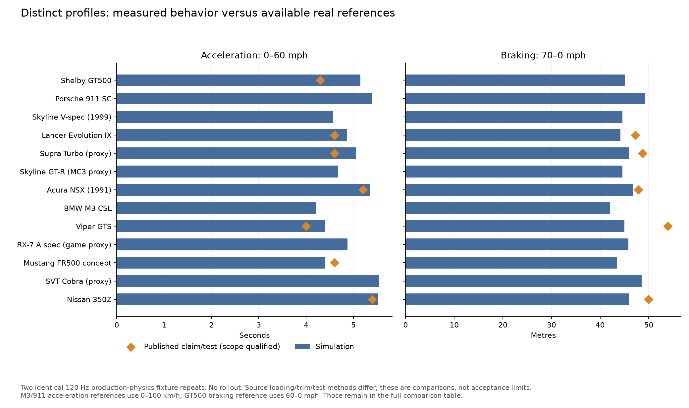

# Per-car physics: implementation, matched fleet tests and real references

All 13 current fleet editions now use explicit profiles rather than the same 1,320 kg chassis, engine force, rear-drive path and suspension constants. The 50-car reference corpus remains separate: this implementation drives the **13 existing editions**, not 50 newly imported vehicles.

The production simulation now uses selected mass, engine output, gearing and drive layout, plus explicitly estimated tire, suspension, CG and inertia parameters. Distinct behavior is demonstrated by production traces and standardized flat-road measurements. Agreement with published performance remains uneven; the comparisons below identify the remaining calibration gaps without treating unlike tests as acceptance limits.

## Profile and evidence map

[Runtime profiles](../../../assets/cars/physics.json) · [frozen tested profiles](tested-profiles.json) · [50-car corpus](../../vehicle-reference/README.md) · [fleet source supplement](fleet-reference-supplement.md) · [machine-readable sources](fleet-reference-supplement.json) · [decision record](../../adr/0004-reference-backed-fleet-physics.md).

Every one of the 23 per-car parameter entries carries `reference`, `related_reference`, `game_proxy` or `estimate`, a basis, and a source for non-estimates. Source identifiers resolve either to a corpus car profile (for example `j01`), a source ID in the fleet supplement, or a native game/key recorded under that car’s `game_catalog` entry (for example `native-fr2-FR500`). These are parameter entries, not counts of scalar elements. `reference` applies to the selected real configuration; the profile's applicability note still controls whether the game asset identifies that exact market, year and trim.

| Fleet edition | Mass kg | Power kW | Drive | Front static weight | Evidence: reference / related / game / estimate |
|---|---:|---:|---|---:|---|
| 350Z | 1506.9 | 214.0 | RWD | 53% | 4 / 1 / 0 / 18 |
| SVT Cobra (unresolved trim) | 1718.0 | 283.4 | RWD | 56% | 0 / 0 / 3 / 20 |
| FR500 concept | 1630.0 | 309.5 | RWD | 50% | 5 / 0 / 1 / 17 |
| RX-7 A spec (game proxy) | 1220.0 | 194.9 | RWD | 50% | 0 / 0 / 6 / 17 |
| Viper GTS (year proxy) | 1530.9 | 335.6 | RWD | 49% | 0 / 6 / 0 / 17 |
| M3 CSL | 1385.0 | 265.0 | RWD | 50% | 9 / 0 / 0 / 14 |
| NSX 1991 5MT | 1365.0 | 201.3 | RWD | 42% | 9 / 0 / 0 / 14 |
| Skyline GT-R (year proxy) | 1560.0 | 205.9 | AWD | 57% | 0 / 7 / 0 / 16 |
| Supra (US Turbo proxy) | 1562.6 | 238.6 | RWD | 53% | 0 / 7 / 0 / 16 |
| Evolution IX (standard US reference) | 1485.0 | 213.3 | AWD | 60% | 8 / 0 / 0 / 15 |
| Skyline V-spec 1999 | 1560.0 | 205.9 | AWD | 57% | 7 / 0 / 0 / 16 |
| 911 SC (European reference) | 1160.0 | 150.0 | RWD | 40% | 8 / 0 / 0 / 15 |
| GT500 2008 coupe | 1778.1 | 372.9 | RWD | 57% | 9 / 0 / 0 / 14 |

The FR2 Cobra's native 380 bhp / 1,718 kg entry cannot be identified as the 2000 Cobra R. The RX-7 A spec lacks a verified real tuner specification. Their game values are explicitly proxies. The FR500's 1,630 kg also comes from the game, while its 415 hp and final drive come from Ford's concept release. Supra market/trim and MC3 Skyline year remain unresolved. Both Skylines share one qualified reference profile; their different model geometry still produces slightly different motion. Do not invent a performance distinction solely because two assets came from different games.

The Supra and Viper transmission assumptions remain estimates: a 1997 Toyota technical document supports the Supra numbers, while the retrieved Viper OEM sheet describes a later generation. The originally cited period articles did not contain numerical gearing; this attribution was corrected before the accepted build and rerun. The source supplement retains the audit.

## Geometry and physics path



Mass and front static weight fraction set physical COM along the authored wheelbase; estimated CG height and a body-sized uniform box set inertia. Spring wheel rates are `corner_mass × (2π × ride_frequency)²`, and damping is `2 × damping_ratio × sqrt(spring × corner_mass)`. These are estimated wheel rates, not recovered coil rates: even where the GT500 corpus contains coil data, wheel motion ratios remain unresolved.

A piecewise estimated torque shape obeys both declared peak torque and peak power limits. Tire radius, gearing and final drive connect speed to engine RPM; launch RPM, shift timing and driveline losses are estimates. The Evo delivers engine force to both axles with a nominal 50:50 split. The Skylines use a rear-biased demand-based transfer approximation, rather than a recovered ATTESA controller. All other current editions are RWD. Per-wheel requested and applied forces are recorded and audited across the actual fleet traces.

Brakes allocate the total request by measured normal load, retaining the combined tire-force limit. The earlier 911 equal-roll normalization has been replaced by each profile's suspension parameters. Narrow track and short wheelbase now interact with the selected mass, CG and spring estimates rather than a fleet-wide equal-response target. Wheel pivots and prepared models were not changed: the Redline 911's 2.330 m authored wheelbase still differs from the 2.272 m real reference.

Drag and rolling resistance are explicit forces; generic linear damping was removed to avoid counting resistance twice. Generic artificial yaw torque/downforce was removed. Shared steering smoothing, angular damping, low-speed reverse and handbrake conveniences remain declared in `shared_estimates`; gravity and air density are fixed constants. This is a reduced-order raycast model with no full rotational tire, ABS or differential-control simulation.

The 350Z assembly pilot now decomposes its selected stock mass/COM/inertia into a residual chassis and four estimated 25 kg wheel assemblies. Removal and restoration still change mass properties atomically and restore the stock profile.

## Same fleet scenarios: matched comparison

The accepted study repeats **13 cars × five scenarios × two repetitions = 130 runs** against the post-911-fix shared-profile version. The checks compare each scenario file, every effective input tick, the roster and all prepared/runtime visual asset hashes. The only intended additional runtime asset is the new physics profile. The accepted executable and frozen source/profile hashes are retained in the protocol and validation files.

These scenarios use three seconds of acceleration before the lower-speed turns and six seconds before braking or faster turns. Because acceleration now differs, braking entry speeds differ. Raw stopping distance alone would confound brake performance with kinetic energy. The table therefore includes entry speed and the descriptive distance-normalized `(entry_speed² − 1²) / (2 × distance)` deceleration to the scenario's 1 m/s threshold. This normalization is not a constant-speed braking experiment; the next section provides that check.

| Fleet edition | Brake entry km/h: old → profile | Distance to 1 m/s m: old → profile | Effective deceleration m/s²: old → profile | Largest turn tilt °: old → profile |
|---|---:|---:|---:|---:|
| 350Z | 98.3 → 102.3 | 34.69 → 37.81 | 10.73 → 10.66 | 4.40 → 2.97 |
| SVT Cobra (unresolved trim) | 98.3 → 103.9 | 34.71 → 41.27 | 10.73 → 10.08 | 4.22 → 3.68 |
| FR500 concept | 98.3 → 119.0 | 34.71 → 48.35 | 10.73 → 11.29 | 4.22 → 2.34 |
| RX-7 A spec (game proxy) | 98.3 → 112.9 | 34.72 → 45.91 | 10.73 → 10.70 | 4.33 → 2.38 |
| Viper GTS (year proxy) | 98.3 → 127.7 | 34.70 → 57.47 | 10.73 → 10.94 | 4.40 → 2.58 |
| M3 CSL | 98.3 → 120.2 | 34.71 → 47.63 | 10.73 → 11.70 | 4.28 → 2.26 |
| NSX 1991 5MT | 98.3 → 105.6 | 34.66 → 41.05 | 10.74 → 10.47 | 4.09 → 2.59 |
| Skyline GT-R (year proxy) | 98.3 → 113.7 | 34.71 → 45.30 | 10.73 → 11.00 | 4.47 → 2.86 |
| Supra (US Turbo proxy) | 98.3 → 111.2 | 34.71 → 44.63 | 10.73 → 10.67 | 4.55 → 3.53 |
| Evolution IX (standard US reference) | 98.3 → 111.4 | 34.71 → 43.08 | 10.73 → 11.10 | 4.35 → 2.95 |
| Skyline V-spec 1999 | 98.3 → 111.5 | 34.71 → 43.59 | 10.73 → 10.99 | 4.34 → 3.03 |
| 911 SC (European reference) | 98.4 → 104.2 | 34.72 → 42.15 | 10.73 → 9.92 | 4.27 → 4.20 |
| GT500 2008 coupe | 98.3 → 112.1 | 34.71 → 44.45 | 10.73 → 10.89 | 4.21 → 3.55 |

The full [comparison CSV](comparison.csv) and [JSON](comparison.json) retain yaw, exit speed, slip, pitch/tilt, support and reset recovery in both turning directions. A smaller tilt angle is not automatically more realistic; these open-loop turns have no matched real-car roll/heading targets.

Maneuver audit: **130 completed runs**, **100% minimum four-wheel contact**, **100% minimum four loaded wheels**, **0 unexpected resets**, **26 deliberate resets**, **0 airborne maneuver ticks** and **1.90 m minimum measured course clearance**. 46/65 repeat groups have byte-identical trajectory digests; the remaining pairs retain their observed numeric ranges, so universal bitwise determinism is not claimed. Maximum repeat spreads were 0.00001240 m for braking distance and 0.00010952° for heading response. [Summary](maneuver-summary.json).

## Standardized flat-road measurements

The separate fixture runs the actual `VehiclePlugin` and Rapier at 120 Hz after 360 settling ticks. Acceleration starts from rest with no rollout and automatic inputs. Braking starts from a settled chassis initialized to exactly 60 mph, 70 mph or 100 km/h and ends at 0.1 m/s. No source target is injected into the fixture. Two complete repeats produced identical measurement JSON. [Protocol and source hashes](benchmark-protocol.json) · [benchmark source](../../../examples/fleet_benchmark.rs).

| Fleet edition | 0–60 mph s | 70–0 mph m |
|---|---:|---:|
| 350Z | 5.517 | 45.89 |
| SVT Cobra (unresolved trim) | 5.542 | 48.55 |
| FR500 concept | 4.400 | 43.51 |
| RX-7 A spec (game proxy) | 4.875 | 45.80 |
| Viper GTS (year proxy) | 4.400 | 45.00 |
| M3 CSL | 4.200 | 41.97 |
| NSX 1991 5MT | 5.342 | 46.76 |
| Skyline GT-R (year proxy) | 4.675 | 44.60 |
| Supra (US Turbo proxy) | 5.058 | 45.91 |
| Evolution IX (standard US reference) | 4.858 | 44.16 |
| Skyline V-spec 1999 | 4.575 | 44.60 |
| 911 SC (European reference) | 5.392 | 49.26 |
| GT500 2008 coupe | 5.150 | 45.05 |



### Comparison against published references

Eighteen compatible metric definitions were retrieved for nine of the 13 editions. The remaining four have measurements but no verified same-speed reference in the bounded research: Cobra, RX-7 A spec and both Skyline editions. They are unvalidated, not silently assigned a target. Manufacturer/dealer claims and related years/trims remain labeled below; source test loading, tires, rollout and optimized launch procedures differ from this fixture.

| Fleet | Metric | Simulation | Reference | Difference | Reference qualification |
|---|---|---:|---:|---:|---|
| FR500 concept | zero_60_mph_s | 4.400 s | 4.600 s | -4.3% | [manufacturer_claim](https://www.terminator-cobra.com/FR500%20is%20Fords%20Ultimate%20Performance%20Parts%20Car.pdf) |
| Viper GTS (year proxy) | zero_60_mph_s | 4.400 s | 4.000 s | +10.0% | [measured_related_year](https://www.caranddriver.com/reviews/a35728264/1997-dodge-viper-gts-vs-porsche-911-turbo-s-vs-acura-nsx-t-comparison-test/) |
| Viper GTS (year proxy) | zero_100_mph_s | 8.767 s | 8.800 s | -0.4% | [measured_related_year](https://www.caranddriver.com/reviews/a35728264/1997-dodge-viper-gts-vs-porsche-911-turbo-s-vs-acura-nsx-t-comparison-test/) |
| Viper GTS (year proxy) | brake_70_mph_0_m | 45.003 m | 53.950 m | -16.6% | [measured_related_year](https://www.caranddriver.com/reviews/a35728264/1997-dodge-viper-gts-vs-porsche-911-turbo-s-vs-acura-nsx-t-comparison-test/) |
| NSX 1991 5MT | zero_60_mph_s | 5.342 s | 5.200 s | +2.7% | [measured_same_launch_model](https://www.caranddriver.com/reviews/comparison-test/a15140663/porsche-911-carrera-4-cabriolet-vs-acura-nsx-chevrolet-corvette-zr-1-ferrari-348ts-lotus-esprit-turbo-se-archived-comparison-test/) |
| NSX 1991 5MT | brake_70_mph_0_m | 46.761 m | 47.854 m | -2.3% | [measured_same_launch_model](https://www.caranddriver.com/reviews/comparison-test/a15140663/porsche-911-carrera-4-cabriolet-vs-acura-nsx-chevrolet-corvette-zr-1-ferrari-348ts-lotus-esprit-turbo-se-archived-comparison-test/) |
| Supra (US Turbo proxy) | zero_60_mph_s | 5.058 s | 4.600 s | +10.0% | [measured_related_year_and_market](https://www.caranddriver.com/reviews/a15142755/toyota-supra-turbo-instrumented-test/) |
| Supra (US Turbo proxy) | brake_70_mph_0_m | 45.910 m | 48.768 m | -5.9% | [measured_related_year_and_market](https://www.caranddriver.com/reviews/a15142755/toyota-supra-turbo-instrumented-test/) |
| 350Z | zero_60_mph_s | 5.517 s | 5.400 s | +2.2% | [measured_related_equipment_grade](https://www.caranddriver.com/reviews/a15136959/nissan-350z-road-test/) |
| 350Z | zero_100_mph_s | 12.525 s | 13.900 s | -9.9% | [measured_related_equipment_grade](https://www.caranddriver.com/reviews/a15136959/nissan-350z-road-test/) |
| 350Z | brake_70_mph_0_m | 45.894 m | 49.987 m | -8.2% | [measured_related_equipment_grade](https://www.caranddriver.com/reviews/a15136959/nissan-350z-road-test/) |
| M3 CSL | zero_100_kmh_s | 4.367 s | 4.900 s | -10.9% | [manufacturer_claim](https://www.press.bmwgroup.com/usa/article/attachment/T0022168EN_US/41493/AG030228_M3_CSL_Press_Kit_GB_finalversion.pdf) |
| M3 CSL | brake_100_0_m | 33.174 m | 34.000 m | within upper bound | [manufacturer_upper_bound](https://www.press.bmwgroup.com/usa/article/attachment/T0022168EN_US/41493/AG030228_M3_CSL_Press_Kit_GB_finalversion.pdf) |
| 911 SC (European reference) | zero_100_kmh_s | 5.650 s | 6.800 s | -16.9% | [manufacturer_hosted_dealer_claim_exact_year_and_engine](https://finder.porsche.com/ch/it-CH/details/porsche-911-sc-coupe-usata-G028QN?sortBy=price.value%5C) |
| GT500 2008 coupe | zero_60_mph_s | 5.150 s | 4.300 s | +19.8% | [measured_exact_year_and_trim](https://www.motortrend.com/reviews/2008-dodge-challenger-srt8-vs-ford-shelby-gt500-comparison-test-archive) |
| GT500 2008 coupe | brake_60_mph_0_m | 33.233 m | 35.966 m | -7.6% | [measured_exact_year_and_trim](https://www.motortrend.com/reviews/2008-dodge-challenger-srt8-vs-ford-shelby-gt500-comparison-test-archive) |
| Evolution IX (standard US reference) | zero_60_mph_s | 4.858 s | 4.600 s | +5.6% | [measured_related_mr_trim](https://www.caranddriver.com/reviews/a18202877/2006-mitsubishi-lancer-evolution-ix-first-drive-review/) |
| Evolution IX (standard US reference) | brake_70_mph_0_m | 44.158 m | 47.244 m | -6.5% | [measured_related_mr_trim](https://www.caranddriver.com/reviews/a18202877/2006-mitsubishi-lancer-evolution-ix-first-drive-review/) |

NSX acceleration/braking and the 350Z's related-grade 0–60 comparison are close to the retrieved tests. The largest visible residuals include the GT500's slower launch, the 911's faster 0–100 km/h against a weaker dealer claim, and overly short Viper braking against the related-year test. These identify the next work; they do not justify overwriting sourced power/mass until estimated launch, tire and braking behavior and test compatibility are examined. The M3's published braking number is an upper bound, so no point-target percentage error is manufactured.

[Complete source-qualified comparisons](real-reference-comparison.csv) · [all measurements, bounds and identity notes](real-reference-comparison.json). Static axle loads in the measurement file can be checked against both declared front weight and total `mass × gravity`. Turn/tilt behavior has no retrieved directly comparable real test and remains a simulation distinction, not established real fidelity.

## Highest-leverage next questions

1. Does the GT500 launch error come from estimated torque shape, shift timing or RWD tire saturation? Its same-speed braking is already shorter than the source test, so increasing tire friction globally would move that result in the wrong direction.
2. Does the 911's optimistic acceleration survive a period factory test with the same European engine, payload and timing convention? Resolve that reference before tuning to a dealer claim.
3. Can a tire/ABS model reproduce the early Viper's longer braking without spoiling acceleration or changing sourced mass/output?
4. Do AWD cars preserve traction on loose or split-friction surfaces? Current evidence verifies the driven axle path on smooth dry pavement, not a rally differential or tire model.
5. With identical physical profiles, how much do the two Skyline model geometries change the response? The matched pair isolates an art/fixture question, subject to the unresolved MC3 trim.
6. Which missing CG, tire and spring/damper measurements most constrain roll and transient response? A controlled lateral-acceleration/roll test would support calibration better than ranking open-loop turn tilt.

## Verification and reproduction

The accepted full gate used `CAR_GAME_MUTE=1 bash scripts/verify.sh --recorded --base HEAD`: format, strict Clippy, complexity, 73 Rust tests, doc tests, Python controls, source asset checks, recorded build, native offscreen 13-car fleet, 52 captures and run verification. The fleet overview and representative driving captures were visually inspected. Additional profile provenance/coverage controls and eight analysis tests passed. Evidence-object checks verify every accepted study bundle. These checks establish build/material identity and measured outcomes, not cross-platform deterministic replay.

The embedded profile is captured separately from the runtime JSON and required to match it. Tampered/missing runtime tuning is rejected. The old cross-car parity assertion was retired because different physical profiles should not be forced to reproduce a shared 350Z response; production tests now check distinct masses, actual static axle loads, drive-force routing and output limits.

Earlier experiments remain under `artifacts/handling-study-profiles-20261023` (20 runs; intentionally stopped after discovering double-counted resistance) and `artifacts/handling-study-profiles-final-20261023` (130 completed before the peak-power cap and evidence-label audit). Neither is the accepted cohort. A subsequent verification build was intentionally stopped to finish the source attribution correction. The accepted cohort is `artifacts/handling-study-profiles-audited-20261023`; no incomplete draft is counted toward acceptance.

```sh
CAR_GAME_MUTE=1 bash scripts/verify.sh --recorded --base HEAD
python3 tools/run_handling_study.py --output artifacts/handling-study-new \
  --binary target/release/car-game.recorded --workers 4
python3 tools/analyze_handling_study.py artifacts/handling-study-new
python3 tools/analyze_profile_study.py \
  --before artifacts/handling-study-911-fix-20261023 \
  --after artifacts/handling-study-new --output artifacts/profile-comparison-new
cargo run --locked --example fleet_benchmark > artifacts/benchmark-new-r1.json
cargo run --locked --example fleet_benchmark > artifacts/benchmark-new-r2.json
python3 tools/compare_fleet_references.py --first artifacts/benchmark-new-r1.json \
  --repeat artifacts/benchmark-new-r2.json --output artifacts/profile-reference-new
python3 -m unittest discover -s tools -p 'test_physics_profiles.py'
python3 tools/test_handling_metrics.py
```

[Validation, logs, executable and evidence hashes](validation.json) · [candidate protocol](candidate-protocol.json) · [candidate metrics and trace hashes](candidate-evidence.json) · [bundle verification results](candidate-provenance-verification.json).

Changes are local and uncommitted. No prepared car model, receipt or roster was modified.
